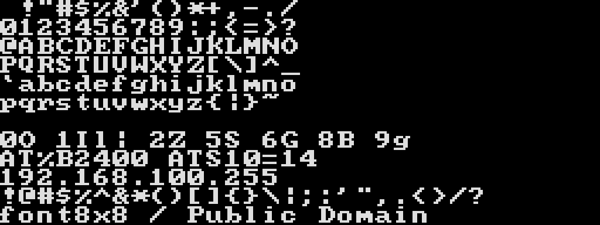

# font8x8の出所・生成・確認手順

## 採用元

ターミナルの印字可能ASCIIには、Daniel Hepper氏の [font8x8](https://github.com/dhepper/font8x8) に含まれる`font8x8_basic.h`を使用します。

| 項目 | 値 |
|---|---|
| upstream commit | `8e279d2d864e79128e96188a6b9526cfa3fbfef9` |
| 対象ファイル | `font8x8_basic.h` |
| 正規化LF SHA-256 | `49d8df366296b203ca3211bc0672cf2a762135bf12710735b6292756b19dffd5` |
| README canonical-LF SHA-256 | `f5cebe166bc38654e3b1a03206c7a5536c3deac6eff460b41213df81338e3a10` |
| upstream表記 | Public Domain |
| 作者表記 | Daniel Hepper |

上流READMEは、このデータがMarcel Sondaar氏のassembler fileとInternational Business Machinesのpublic-domain VGA fontsから直接派生したものだと説明しています。上流にはCC0などの独立した正式ライセンス文書はなく、READMEとsource headerのPublic Domain宣言がライセンス証跡です。

原本、README、固定コミット、URL、ハッシュ、由来は`third_party/font8x8`に保存します。通常の生成・ビルドはネットワークへ接続しません。

## SFC形式への変換

上流は各文字を8行、各行1バイトで表し、bit 0を左端pixelとします。生成処理は次を行います。

1. 原本の正規化LF SHA-256、Public Domain表記、128 codepointの完全性を検証する。
2. `$20`から`$7E`までの95文字だけを採用する。
3. 各行のbit順を反転し、SFC 2bpp tileのplane 0へ格納する。
4. plane 1を0にする。
5. 制御文字、`$7F`、`$80`から`$FF`までのtileを0で埋める。

生成される`assets/font.bin`は256 tile × 16 byteの4096 byteです。初回採用時の字形修正はありません。将来追加するglyph差分と変換codeにはprojectのMIT Licenseを適用します。

## 配色

`spec/ndm24.toml`の`[terminal]`から512 byteの`assets/palette.bin`を生成します。

| palette index | BGR555 | 用途 |
|---:|---:|---|
| 0 | `$0000` | 完全な黒の背景 |
| 1 | `$6F7B` | `RGB(222,222,222)`相当の文字 |
| 2 | `$0000` | 未使用 |
| 3 | `$0000` | 未使用 |

fontはindex 1だけを使います。未使用色を黒にすることで、plane 1が誤って設定されたpixelを目視しやすくします。

## 生成と確認

```powershell
cargo xtask generate
cargo xtask generate --check
cargo xtask rom --font-test
cargo xtask deploy --font-test
```

`generate`は`font.bin`、`palette.bin`、font test用Assembly、次のPNGを同じ入力から生成します。PNGは生成済みSFC 2bppデータを読み戻し、nearest-neighborで4倍に拡大したものです。



フォント確認ROMはNDM24を初期化せず、全印字可能ASCIIと次の判別用文字列を32文字幅ターミナルへ表示します。

```text
0O 1Il| 2Z 5S 6G 8B 9g
AT%B2400 ATS10=14
192.168.100.255
!@#$%^&*()[]{}\|;:'",.<>/?
font8x8 / Public Domain
```

最終的な視認性はFXPAK PRO、SFC実機、RGBからHDMIへの変換環境で確認します。

## ROM内の出所情報

すべてのROMには作者、Public Domain表記、由来、固定commit、upstream URLをASCIIデータとして埋め込みます。通常ROMとスモークテストROMの起動画面には表示しません。フォント確認ROMだけ、短い`font8x8 / Public Domain`を表示します。
