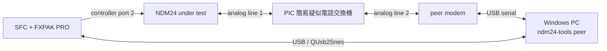

# NDM24 ハードウェアテスト

## 安全上の前提

秋月電子通商の [PIC 簡易疑似電話交換機](https://akizukidenshi.com/catalog/g/g117755/) を NDM24 と相手側モデムの間に置き、閉じた疑似 PSTN を構成します。この装置は発信側のダイヤル内容を交換先の選択に使わず、2 ポート間を 1 対 1 で接続する仕様です。配線・ring cadence・電源条件は製品の[取扱説明書](https://akizukidenshi.com/goodsaffix/manu030.pdf)を正本とします。

疑似交換機のポートを公衆電話網や外部の電話設備へ接続しません。NDM24 の公衆 PSTN 用個体と分解・計測用個体も取り違えないよう、個体 ID と hardware revision を試験記録に残します。

## 配線



## クイックテスト

1. NDM24、SFC、FXPAK PRO、QUsb2Snes を接続します。
2. `cargo xtask deploy --smoke` で ROM を転送して起動します。
3. `cargo run -p ndm24-tools -- test` を実行します。
4. command が `passed` になり、診断状態が `ready` であることを確認します。
5. `cargo run -p ndm24-tools -- monitor --once` を保存します。
6. `cargo run -p ndm24-tools -- trace-live` を保存します。

合格条件:

- `AT` に対する `OK` を受け、有限時間内に `READY` になる。
- raw `R` 後は約10秒待ってから初回probeが始まり、`tx_bytes=4`、`timeout=0` で成功する。
- 初回probeの表示ミラー末尾が `41 54 0D 0D 0A 4F 4B 0D 0A`（`AT CR CR LF OK CR LF`）になる。
- `last_error`、RX/TX overflow が 0。
- 9-bit RX-presentが1のecho/応答だけを受理し、Data2 hintが0になった後もRX-presentが続く末尾文字を欠落しない。
- 16-bit pollでもData2 hintにかかわらずRX-presentが成立した先頭byteを受理し、AT echoの先頭を欠落しない。
- `READY` 遷移後はAT probeの末尾LFがRX queueに残っていない。
- エラー時は `ERROR` へ遷移し、トレースが凍結する。

## AT識別情報

NDM24を回線へ接続せず、初期probeが `READY` になった状態で次を実行します。

```powershell
cargo run -p ndm24-tools -- identify --revision B
```

`ATI`、`ATI0`～`ATI9`とV.250の `AT+GMI`、`AT+GMM`、`AT+GMR`、`AT+GSN`、`AT+GCAP` を照会します。いずれも読み取り専用で、設定変更や発信は行いません。未対応コマンドの `ERROR` もrevision固有の結果として保存します。各応答はtraceのRX accepted eventからraw byte列を復元し、終端検出後100ms以内に後着したbyteもRX ringから取得して統合します。ATI2のchecksum結果 `OK` のように終端結果と同じ情報行が先行する場合は、最後の行だけを終端として除外します。応答終端が得られずタイムアウトした場合も、それ以前の全結果と失敗コマンドの前後snapshot、受信・送信byte数差分、利用可能なtraceを保存して照会を終了します。行単位の情報とsnapshotは `build/hardware-tests/<test-id>/at-identification.json` へ記録します。

合格条件:

- 対応コマンドは `OK` または `ERROR` などの終端結果まで完了する。無応答のコマンドはタイムアウトとして明示され、後続コマンドを実行しない。
- raw responseをtraceから欠落なく復元でき、trace overwriteとRX discardが0。
- 全照会後も `READY` で、RX ringが空、error、timeout、RX/TX overflowが0。
- 32byteを超える連続応答ではpoll budget exhaustionを許容する。コマンド別の増分を記録し、次のメインループで継続してraw responseが完全に取得できたことを確認する。

## 疑似 PSTN 接続テスト

1. 疑似交換機の line 1 に NDM24、line 2 に相手側モデムを接続します。
2. 後期hardware revisionを `revision B`、前期を `revision A` として試験記録へ記載します。
3. smoke ROMを転送し、初期 `AT` probeが `READY` になったことを確認します。
4. `cargo run -p ndm24-tools -- connect-test --revision B --port COM5` を実行します。revision Aでは引数を `--revision A` に変更します。
5. 接続試験合格後、`cargo run -p ndm24-tools -- binary-test --revision B --port COM5` を実行します。revision Aでは同様に引数を変更します。
6. quick run の後、`cargo run -p ndm24-tools -- connect-test --revision B --port COM5 --hold-seconds 1800` で30分のcarrier soakを行います。revision Aでは同様に引数を変更します。

`connect-test` はDFM-56Uへ `ATZ`、`ATE0`、`AT&D2`、`AT+MS=V22B,0,2400,2400,2400,2400`、`ATS0=1` を送り、各 `OK` を確認します。NDM24側はホスト駆動の汎用AT transactionで `AT&F`、`AT%B2400`、`ATS7=60`、`ATX3`、`ATDT0` を1回ずつ実行します。疑似交換機にダイヤルトーンはなく、オフフックから数秒後に相手側を呼び出すため、`ATX3` でdial tone待ちを無効にします。番号 `0` は発信動作を開始するための非実在値で、疑似交換機はroutingに使いません。report schema version 2以降は各transaction前後のRX discard counterと、接続保持終了時にRX ringへ残っていたraw byte列を保存します。version 3以降はDTRを下げた1秒後、`NO CARRIER` parserを開始する直前のraw RX列も保存します。

接続試験の合格条件:

- DFM-56UとNDM24の両側が `CONNECT` を返す。
- V.22bis 2400bpsで10秒間carrierを保持する。
- DFM-56UのDTR低下後、NDM24が `NO CARRIER` を返す。
- `last_error`、timeout、RX/TX overflow、poll limitが0。
- AT parserが末尾LFまで消費し、試験終了時のRX ringが空。
- 日時・revision・AT transcript・SFC snapshot・transaction別traceを `build/hardware-tests/<test-id>/connect-test.json` へ保存する。

`binary-test` は接続設定に加えてDFM-56Uへ `AT&K0` を送り、DTE flow controlを無効にします。接続後、全256値を昇順にNDM24→DFM-56U、DFM-56U→NDM24へ1回ずつ転送します。SFC側mailboxの1命令は最大31byteとし、TX ringが空になったことを確認してから次のchunkへ進みます。DFM-56U→NDM24ではV.22bis上のchunk到着時間と100msの余裕を待ち、RX ringを直接記録してからmailboxでdrainします。これにより回線・低レベルpollの結果とmailbox返却値を分離して診断します。

QUsb2Snesからmailboxを読む際は、96byte全体が2回連続で一致するまで制御結果を確定しません。SFC専用outputは別のQUsb2Snes接続から32byteだけを2回読み、一致した値を採用します。完了済みの制御欄と更新前のoutput欄が混在した一時的な読み取りを、受信データとして扱わないためです。

mailbox ABI version 3では、arguments 32byteをホスト→SFC専用、output 32byteをSFC→ホスト専用にします。FXPAK PROの `SETX` でホストが書いた領域をSFC出力として再利用しません。

binary pattern試験の合格条件:

- 双方向とも受信列が `0x00`～`0xFF` と完全一致し、欠落、重複、順序変更がない。
- 転送後のRX/TX ringが空で、error、timeout、RX/TX overflow、poll limitが0。
- DTR切断後にNDM24が `NO CARRIER` を返して `READY` へ戻る。
- expected/received byte列、chunkごとのdrain前RX ring、AT transcript、SFC snapshot、transfer traceを `build/hardware-tests/<test-id>/binary-pattern-test.json` へ保存する。

接続失敗時は自動再発信しません。30分soak中もRX/TX ring、error、timeout、overflow、poll limit、discardを監視し、保持終了後のDTR切断、`NO CARRIER`、`READY`復帰までを同じconnect reportへ保存します。

## hardware revision matrix

各試験は 2 種類の NDM24 hardware revision で実施します。技適番号そのものは個体管理表に記録し、ここでは revision A/B とします。

| 試験 | revision A | revision B |
|---|---|---|
| raw `R` とランプ挙動 | 合格 (2026-07-29) | 合格 (2026-07-29) |
| `AT` quick test | 合格 (2026-07-29) | 合格 (2026-07-29) |
| AT識別情報 | 取得済み (2026-07-29) | 取得済み (2026-07-29) |
| 疑似 PSTN connect | 合格 (2026-07-29) | 合格 (2026-07-29) |
| binary pattern | 合格 (2026-07-29) | 合格 (2026-07-29) |
| 30 分 soak | 合格 (2026-07-29) | 未実施 |

revision B の最新の疑似 PSTN connect 合格記録は test ID `unix-1785312449-revision-b` です。`AT&F`、`AT%B2400`、`ATS7=60`、`ATX3`、`ATDT0` のechoはすべて完全で、各transaction前後のRX discard counterは0のままでした。DFM-56U は `RING`、`CONNECT 115200` を返し、NDM24 は `CONNECT 2400` を受信して `CONNECTED` へ遷移しました。10秒保持中の未処理RXは0byteです。DFM-56UのDTRを下げた後にはキャリア切断過渡の `7F D5 86 8C CA 58 BA` が入り、続く `NO CARRIER` を受信して `READY` へ戻りました。最終snapshotはRX read/write indexがともに103、error、timeout、RX/TX overflow、poll limit、terminal droppedがすべて0です。transaction別trace、双方のAT transcript、切断前後のraw RX列は `build/hardware-tests/unix-1785312449-revision-b/connect-test.json` に保存されています。

revision B のbinary pattern合格記録は test ID `unix-1785315378-revision-b` です。V.22bis 2400bpsで `0x00`～`0xFF` を双方へ256byteずつ転送し、NDM24→DFM-56U、DFM-56U→NDM24とも不一致0でした。DFM-56U→NDM24の全9chunkは、drain前RX ringとmailbox ABI version 3のSFC専用outputの両方が期待値と完全一致しました。転送中は `CONNECTED`、DTR切断と `NO CARRIER` 後は `READY` で、最終RX read/write indexは104/104、TX read/write indexは42/42です。error、timeout、RX/TX overflow、poll limit、discard、terminal droppedはすべて0で、256件のtransfer traceと切断過渡raw byte列を `build/hardware-tests/unix-1785315378-revision-b/binary-pattern-test.json` に保存しています。

revision B のAT識別情報は [NDM24 AT識別情報](ndm24-hardware-identification.md)にまとめています。正式記録のtest IDは `unix-1785316604-revision-b-identification` で、16コマンドすべてが `OK` または `ERROR` まで完了し、最終状態は `READY`、error、timeout、overflow、discard、trace overwriteはいずれも0でした。

revision A のAT識別情報も同じ文書にまとめています。正式記録のtest IDは `unix-1785317352-revision-a-identification` です。16コマンドすべてが完了し、最終状態は `READY`、error、timeout、overflow、discard、trace overwriteはいずれも0でした。`ATI3`、`ATI4`、`ATI5` の長い応答ではpoll budget exhaustionが各1回発生しましたが、次のメインループで継続され、raw responseは欠落なく取得できています。

revision A のquick testではraw `R`を含む初期化と `AT` probeを2回実行し、最終状態は `READY`、RX read/write indexは9/9、TX read/write indexは4/4でした。error、timeout、RX/TX overflow、poll limit、discard、terminal droppedはすべて0です。その後、raw `R`による初期化を単独で再実行し、電源ランプが一定時間点滅することを目視確認しました。後続の `AT` probeも成功し、`READY`へ復帰しています。

revision A の疑似 PSTN connect合格記録はtest ID `unix-1785319664-revision-a` です。DFM-56Uは `CONNECT 115200`、NDM24は `CONNECT 2400` を返し、10秒保持中の未処理RXは0byteでした。DTR切断直後にはキャリア切断過渡の `F0 0D C9 D7 5D 3A D8 79 FD 1A 05` が入り、その後 `NO CARRIER` を受信して `READY` へ戻りました。最終RX read/write indexは107/107、TX read/write indexは42/42で、error、timeout、RX/TX overflow、poll limit、discard、terminal droppedはすべて0です。記録は `build/hardware-tests/unix-1785319664-revision-a/connect-test.json` に保存しています。

revision A のbinary pattern合格記録はtest ID `unix-1785319727-revision-a` です。V.22bis 2400bpsで `0x00`～`0xFF` を双方へ256byteずつ転送し、NDM24→DFM-56U、DFM-56U→NDM24とも不一致0でした。DFM-56U→NDM24の全9chunkはdrain前RX ringとmailbox outputの両方が期待値と完全一致しています。最終状態は `READY`、RX read/write indexは205/205、TX read/write indexは80/80で、error、timeout、RX/TX overflow、poll limit、discard、terminal droppedはすべて0です。記録は `build/hardware-tests/unix-1785319727-revision-a/binary-pattern-test.json` に保存しています。

revision A の30分carrier soak合格記録はtest ID `unix-1785320450-revision-a` です。V.22bis 2400bpsのcarrierを1800秒保持し、5分ごとの中間snapshotはいずれも `CONNECTED`、RX/TX ring空、error、timeout、RX/TX overflow、poll limit、discard、terminal droppedが0でした。保持終了後、DTR切断直後にキャリア切断過渡の `01 A1 20 46 D3 E3 DE 74 C8 FE D2 87` が入り、その後 `NO CARRIER` を受信して `READY`へ復帰しました。最終RX read/write indexは108/108、TX read/write indexは42/42で、全エラーカウンタは0です。記録は `build/hardware-tests/unix-1785320450-revision-a/connect-test.json` に保存しています。

実機試験を行うまでは、ビルド成功をハードウェア合格として扱いません。差が出た場合は診断 snapshot、trace、QUsb2Snes 時刻、必要に応じてロジックアナライザ capture を同じ試験 ID に紐付けます。
