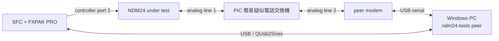

# NDM24 ハードウェアテスト

## 安全上の前提

秋月電子通商の [PIC 簡易疑似電話交換機](https://akizukidenshi.com/catalog/g/g117755/) を NDM24 と相手側モデムの間に置き、閉じた疑似 PSTN を構成します。この装置は発信側のダイヤル内容を交換先の選択に使わず、2 ポート間を 1 対 1 で接続する仕様です。配線・ring cadence・電源条件は製品の[取扱説明書](https://akizukidenshi.com/goodsaffix/manu030.pdf)を正本とします。

疑似交換機のポートを公衆電話網や外部の電話設備へ接続しません。NDM24 の公衆 PSTN 用個体と分解・計測用個体も取り違えないよう、個体 ID と hardware revision を試験記録に残します。

## 配線

## クイックテスト

1. NDM24、SFC、FXPAK PRO、QUsb2Snes を接続します。
2. `cargo xtask deploy --smoke` で ROM を転送して起動します。
3. `cargo run -p ndm24-tools -- test` を実行します。
4. command が `passed` になり、診断状態が `ready` であることを確認します。
5. `cargo run -p ndm24-tools -- monitor --once` を保存します。
6. `cargo run -p ndm24-tools -- trace-live` を保存します。

合格条件:

- `AT` に対する `OK` を受け、有限時間内に `READY` になる。
- `last_error`、RX/TX overflow が 0。
- 受理した echo/応答に、ready または RX-present が無効な重複候補が混ざらない。
- エラー時は `ERROR` へ遷移し、トレースが凍結する。

## 疑似 PSTN 接続テスト

1. 疑似交換機の line 1 に NDM24、line 2 に相手側モデムを接続します。
2. PC で `ndm24-tools peer` を起動し、相手側モデムを初期化して auto-answer にします。
3. SFC 側から試験用 dial profile を送ります。疑似交換機はダイヤル内容を routing に使いません。
4. `CONNECT` 後、既知の binary pattern を双方向へ送り、一致、順序、欠落、重複を確認します。
5. quick run の後、30 分の soak run を行います。

現在の milestone は `AT` クイックテストまでを自動化しています。dial、pattern transfer、30 分 soak の自動 command は PPP 実装前の次段階で追加します。電話番号を source code や profile に固定しません。

## hardware revision matrix

各試験は 2 種類の NDM24 hardware revision で実施します。技適番号そのものは個体管理表に記録し、ここでは revision A/B とします。

| 試験 | revision A | revision B |
|---|---|---|
| raw `R` とランプ挙動 | 未実施 | 未実施 |
| `AT` quick test | 未実施 | 未実施 |
| 疑似 PSTN connect | 未実施 | 未実施 |
| binary pattern | 未実施 | 未実施 |
| 30 分 soak | 未実施 | 未実施 |

実機試験を行うまでは、ビルド成功をハードウェア合格として扱いません。差が出た場合は診断 snapshot、trace、QUsb2Snes 時刻、必要に応じてロジックアナライザ capture を同じ試験 ID に紐付けます。
