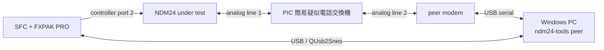

# NDM24 ハードウェアテスト

## 安全上の前提

秋月電子通商の [PIC 簡易疑似電話交換機](https://akizukidenshi.com/catalog/g/g117755/) を NDM24 と相手側モデムの間に置き、閉じた疑似 PSTN を構成します。この装置は発信側のダイヤル内容を交換先の選択に使わず、2 ポート間を 1 対 1 で接続する仕様です。配線・ring cadence・電源条件は製品の[取扱説明書](https://akizukidenshi.com/goodsaffix/manu030.pdf)を正本とします。

疑似交換機のポートを公衆電話網や外部の電話設備へ接続しません。NDM24 の公衆 PSTN 用個体と分解・計測用個体も取り違えないよう、個体 ID と hardware revision を試験記録に残します。

## 配線



## クイックテスト

1. NDM24、SFC、FXPAK PRO、QUsb2Snes を接続します。
2. `cargo xtask deploy --smoke` で ROM を転送して起動します。
3. `cargo run -p ndm24-tools -- test` を実行します。
4. command が `passed` になり、診断状態が `ready` であることを確認します。
5. `cargo run -p ndm24-tools -- monitor --once` を保存します。
6. `cargo run -p ndm24-tools -- trace-live` を保存します。

合格条件:

- `ATM0` に対する `OK` を受け、スピーカーを無効にして有限時間内に `READY` になる。
- raw `R` 後は約10秒待ってから初回probeが始まり、`tx_bytes=6`、`timeout=0` で成功する。
- 初回probeの表示ミラー末尾が `41 54 4D 30 0D 0D 0A 4F 4B 0D 0A`（`ATM0 CR CR LF OK CR LF`）になる。
- `last_error`、RX/TX overflow が 0。
- 9-bit RX-presentが1のecho/応答だけを受理し、Data2 hintが0になった後もRX-presentが続く末尾文字を欠落しない。
- 16-bit pollでもData2 hintにかかわらずRX-presentが成立した先頭byteを受理し、AT echoの先頭を欠落しない。
- `READY` 遷移後は `ATM0` probeの末尾LFがRX queueに残っていない。
- エラー時は `ERROR` へ遷移し、トレースが凍結する。

## AT識別情報

NDM24を回線へ接続せず、初期probeが `READY` になった状態で次を実行します。

```powershell
cargo run -p ndm24-tools -- identify --revision B
```

`ATI`、`ATI0`～`ATI9`とV.250の `AT+GMI`、`AT+GMM`、`AT+GMR`、`AT+GSN`、`AT+GCAP` を照会します。いずれも読み取り専用で、設定変更や発信は行いません。未対応コマンドの `ERROR` もrevision固有の結果として保存します。各応答はtraceのRX accepted eventからraw byte列を復元し、終端検出後100ms以内に後着したbyteもRX ringから取得して統合します。ATI2のchecksum結果 `OK` のように終端結果と同じ情報行が先行する場合は、最後の行だけを終端として除外します。応答終端が得られずタイムアウトした場合も、それ以前の全結果と失敗コマンドの前後snapshot、受信・送信byte数差分、利用可能なtraceを保存して照会を終了します。行単位の情報とsnapshotは `build/hardware-tests/<test-id>/at-identification.json` へ記録します。

合格条件:

- 対応コマンドは `OK` または `ERROR` などの終端結果まで完了する。無応答のコマンドはタイムアウトとして明示され、後続コマンドを実行しない。
- raw responseをtraceから欠落なく復元でき、trace overwriteとRX discardが0。
- 全照会後も `READY` で、RX ringが空、error、timeout、RX/TX overflowが0。
- 32byteを超える連続応答では `poll_budget_yield` を正常な協調動作として許容する。コマンド別の増分を記録し、次のメインループで継続してraw responseが完全に取得できたことを確認する。

identification report schema version 3以降は診断snapshotとコマンド別カウンタを `poll_budget_yield` という名前で保存します。version 2以前の既存記録では、同じoffsetと動作の値を旧名 `poll_limit` で保存しています。

## 疑似 PSTN 接続テスト

1. 疑似交換機の line 1 に NDM24、line 2 に相手側モデムを接続します。
2. 後期hardware revisionを `revision B`、前期を `revision A` として試験記録へ記載します。
3. smoke ROMを転送し、初期 `ATM0` probeが `READY` になったことを確認します。
4. `cargo run -p ndm24-tools -- connect-test --revision B --port COM5` を実行します。revision Aでは引数を `--revision A` に変更します。
5. 接続試験合格後、`cargo run -p ndm24-tools -- binary-test --revision B --port COM5` を実行します。revision Aでは同様に引数を変更します。
6. quick run の後、`cargo run -p ndm24-tools -- connect-test --revision B --port COM5 --hold-seconds 1800` で30分のcarrier soakを行います。revision Aでは同様に引数を変更します。

`connect-test` はDFM-56Uへ `ATZ`、`ATE0`、`AT&D2`、`AT+MS=V22B,0,2400,2400,2400,2400`、`ATS0=1` を送り、各 `OK` を確認します。NDM24側はホスト駆動の汎用AT transactionで `AT&F`、`ATM0`、`AT%B2400`、`ATS7=60`、`ATX3`、`ATDT0` を1回ずつ実行します。`AT&F` はスピーカー設定を既定値へ戻すため、直後の `ATM0` は省略しません。疑似交換機にダイヤルトーンはなく、オフフックから数秒後に相手側を呼び出すため、`ATX3` でdial tone待ちを無効にします。番号 `0` は発信動作を開始するための非実在値で、疑似交換機はroutingに使いません。report schema version 2以降は各transaction前後のRX discard counterと、接続保持終了時にRX ringへ残っていたraw byte列を保存します。version 3以降はDTRを下げた1秒後、`NO CARRIER` parserを開始する直前のraw RX列も保存します。version 4以降は診断snapshotを `poll_budget_yield` という名前で保存します。

接続試験の合格条件:

- DFM-56UとNDM24の両側が `CONNECT` を返す。
- V.22bis 2400bpsで10秒間carrierを保持する。
- DFM-56UのDTR低下後、NDM24が `NO CARRIER` を返す。
- `last_error`、timeout、RX/TX overflowが0。`poll_budget_yield` の発生は記録するが、失敗条件にはしない。
- AT parserが末尾LFまで消費し、試験終了時のRX ringが空。
- 日時・revision・AT transcript・SFC snapshot・transaction別traceを `build/hardware-tests/<test-id>/connect-test.json` へ保存する。

`binary-test` は接続設定に加えてDFM-56Uへ `AT&K0` を送り、DTE flow controlを無効にします。接続後、全256値を昇順にNDM24→DFM-56U、DFM-56U→NDM24へ1回ずつ転送します。SFC側mailboxの1命令は最大31byteとし、TX ringが空になったことを確認してから次のchunkへ進みます。DFM-56U→NDM24ではV.22bis上のchunk到着時間と100msの余裕を待ち、RX ringを直接記録してからmailboxでdrainします。これにより回線・低レベルpollの結果とmailbox返却値を分離して診断します。report schema version 3以降は、NDM24→DFM-56Uの256byte送信が終わった直後にtraceをfreezeして `sfc_to_peer_trace` へ保存し、後半の受信試験でTX eventが上書きされることを防ぎます。

report schema version 4以降は通常の31byte chunk試験に加え、SFCの255byte TX ringを `0x00`～`0xFE` で一度に満たす最大burst試験を行います。DFM-56Uで受信した列を完全比較し、burst前後のsnapshotと直後のtraceを独立保存します。255byteは32-transferのpoll budgetで7回yieldし、最後の31byteで完了するため、この区間に限って `poll_budget_yield` countの増分7とflagを期待値として扱います。通常送信では見えないNDM24入力bufferの飽和やbackpressure信号を探索するための試験です。version 5以降は診断snapshotも新名称で保存し、通常区間のyieldを失敗条件から除外します。

QUsb2Snesからmailboxを読む際は、96byte全体が2回連続で一致するまで制御結果を確定しません。SFC専用outputは別のQUsb2Snes接続から32byteだけを2回読み、一致した値を採用します。完了済みの制御欄と更新前のoutput欄が混在した一時的な読み取りを、受信データとして扱わないためです。

mailbox ABI version 4では、version 3のarguments/output所有権分離を維持し、デバッグ専用の255byte TX stress命令を追加します。arguments 32byteはホスト→SFC専用、output 32byteはSFC→ホスト専用で、FXPAK PROの `SETX` でホストが書いた領域をSFC出力として再利用しません。

binary pattern試験の合格条件:

- 双方向とも受信列が `0x00`～`0xFF` と完全一致し、最大burstのSFC→DFM-56U受信列も `0x00`～`0xFE` と完全一致して、欠落、重複、順序変更がない。
- 転送後のRX/TX ringが空で、error、timeout、RX/TX overflowが0。`poll_budget_yield` は通常区間では失敗条件にせず、制御された最大burst区間では増分が厳密に7であることを確認する。
- DTR切断後にNDM24が `NO CARRIER` を返して `READY` へ戻る。
- expected/received byte列、chunkごとのdrain前RX ring、AT transcript、SFC snapshot、SFC送信直後trace、受信試験traceを `build/hardware-tests/<test-id>/binary-pattern-test.json` へ保存する。

接続失敗時は自動再発信しません。30分soak中もRX/TX ring、error、timeout、overflow、`poll_budget_yield`、discardを監視し、保持終了後のDTR切断、`NO CARRIER`、`READY`復帰までを同じconnect reportへ保存します。`poll_budget_yield` は推移を保存しますが、単独では失敗としません。

## PPP LCP接続試験

DFM-56UをWindowsのCOM5からWSL2の`/dev/ttyACM0`へUSBIPで切り替え、
`pppd`を対向serverとして使います。serverの導入、V.22bis固定条件、PAP要求、
ログ取得、停止手順は[WSL2 PPPサーバー](ppp-server.md)を正本とします。

LCP試験に続き、PAP Authenticate-Request/Ack、IPCP `Opened`、SFC側local
`10.24.0.2`、peer `10.24.0.1`、password非記録、切断後のLCP/IPCP
`Closed`とPAP `Inactive`までをSFC診断ABIと`pppd`ログで照合済みです。
対向からのLCP Terminate-Requestには同じIdentifierのTerminate-Ackを1回返し、
Ack送信中に上位層のlower-downが共有送信器を中止しないことも確認します。
試験中は従来の
`connect-test --port COM5`と`binary-test --port COM5`を同時に実行しません。

## hardware revision matrix

各試験は 2 種類の NDM24 hardware revision で実施します。技適番号そのものは個体管理表に記録し、ここでは revision A/B とします。

| 試験 | revision A | revision B |
|---|---|---|
| raw `R` とランプ挙動 | 合格 (2026-07-29) | 合格 (2026-07-29) |
| `AT` quick test | 合格 (2026-07-29) | 合格 (2026-07-29) |
| AT識別情報 | 取得済み (2026-07-29) | 取得済み (2026-07-29) |
| 疑似 PSTN connect | 合格 (2026-07-29) | 合格 (2026-07-29) |
| binary pattern | 合格 (2026-07-29) | 合格 (2026-07-29) |
| TX 255byte最大burst | 合格 (2026-07-29) | 合格 (2026-07-29) |
| 30 分 soak | 合格 (2026-07-29) | 未実施 |
| NMITIMEN gating回帰 | 合格 (2026-07-29) | 合格 (2026-07-29) |
| PPP LCP実対向 | 合格 (2026-07-30) | 未実施 |
| PPP LCP peer起点正常終了 | 合格 (2026-07-30) | 未実施 |
| PPP PAP認証 | 合格 (2026-07-30) | 未実施 |
| PPP IPCPセルフテスト | 合格 (2026-07-30) | 未実施 |
| PPP IPCP実対向 | 合格 (2026-07-30) | 未実施 |
| PPP IPCP RFC 1877 DNS交渉 | 合格 (2026-07-30) | 未実施 |
| PPP IPv4セルフテスト | 合格 (2026-07-30) | 未実施 |
| PPP ICMP Echoセルフテスト | 合格 (2026-07-30) | 未実施 |
| PPP UDP datagramセルフテスト | 合格 (2026-07-30) | 未実施 |
| PPP NTP clientセルフテスト | 合格 (2026-07-30) | 未実施 |
| PPP DNS A clientセルフテスト | 合格 (2026-07-30) | 未実施 |
| PPP IPv4実対向 | 合格 (2026-07-30) | 未実施 |
| PPP ICMP Echo実対向 | 合格 (2026-07-30) | 未実施 |
| PPP 外向きICMP Echo／NAT | 合格 (2026-07-30) | 未実施 |
| PPP 外向きDNS／UDP／NAT | 合格 (2026-07-30) | 未実施 |
| PPP NTP実対向 | 合格 (2026-07-30) | 未実施 |

revision B の最新の疑似 PSTN connect 合格記録は test ID `unix-1785329111-revision-b` です。`AT&F`、`AT%B2400`、`ATS7=60`、`ATX3`、`ATDT0` のechoはすべて完全で、各transaction前後のRX discard counterは0のままでした。DFM-56U は `RING`、`CONNECT 115200` を返し、NDM24 は `CONNECT 2400` を受信して `CONNECTED` へ遷移しました。10秒保持中の未処理RXは0byteです。DFM-56UのDTRを下げた直後にはキャリア切断過渡の `07 99 62 A1 74 DD 6B EE 1E` が入り、続く `NO CARRIER` を受信して `READY` へ戻りました。最終snapshotはRX read/write indexがともに105、TX read/write indexがともに42で、error、timeout、RX/TX overflow、`poll_budget_yield`、discard、terminal droppedがすべて0です。transaction別trace、双方のAT transcript、切断前後のraw RX列は `build/hardware-tests/unix-1785329111-revision-b/connect-test.json` に保存されています。旧schemaのJSONでは `poll_budget_yield` と同じ値が `poll_limit` という名前で記録されています。

revision B の最新のbinary pattern合格記録は test ID `unix-1785330333-revision-b` です。V.22bis 2400bpsで `0x00`～`0xFF` を双方へ256byteずつ転送し、NDM24→DFM-56U、DFM-56U→NDM24とも不一致0でした。さらにTX ring全容量へ一度にqueueした `0x00`～`0xFE` の255byte最大burstもDFM-56Uで完全一致しました。burst前後のTX byte countは298から553、TX ringは42/42から41/41へ一周して空に戻り、予定どおり7回 `poll_budget_yield` しました。stress traceに残った96件のTX eventはすべてData2=`$0200`で、途中の状態変化はありません。最終状態は `READY`、RX read/write index 105/105、TX read/write index 41/41です。error、timeout、RX/TX overflow、discard、terminal droppedは0、`poll_budget_yield` は最大burstの期待値7です。記録は `build/hardware-tests/unix-1785330333-revision-b/binary-pattern-test.json` に保存しています。

revision B のAT識別情報は [NDM24 AT識別情報](ndm24-hardware-identification.md)にまとめています。正式記録のtest IDは `unix-1785316604-revision-b-identification` で、16コマンドすべてが `OK` または `ERROR` まで完了し、最終状態は `READY`、error、timeout、overflow、discard、trace overwriteはいずれも0でした。

revision A のAT識別情報も同じ文書にまとめています。正式記録のtest IDは `unix-1785317352-revision-a-identification` です。16コマンドすべてが完了し、最終状態は `READY`、error、timeout、overflow、discard、trace overwriteはいずれも0でした。`ATI3`、`ATI4`、`ATI5` の長い応答では `poll_budget_yield` が各1回発生しましたが、次のメインループで継続され、raw responseは欠落なく取得できています。

revision A の `ATM0` 標準初期化回帰では、ROM起動後の初回probeが受信11byte、送信6byteで完了し、RX read/write index 11/11、TX read/write index 6/6、`READY`、timeout 0でした。疑似PSTN接続試験の後にraw `R`を伴うquick reinitializeも実行し、`reinitialize=2`、RX read/write index 11/11、TX read/write index 6/6、最終結果 `OK` で再び `READY` へ復帰しました。これにより電源投入時と明示的な再初期化時の双方で `ATM0` が送られることを確認しています。以前のraw `R`単独試験で確認した電源ランプの点滅波形は変更していません。

revision A の最新の疑似PSTN connect合格記録はtest ID `unix-1785335528-revision-a` です。NDM24側のtransactionは `AT&F`、`ATM0`、`AT%B2400`、`ATS7=60`、`ATX3`、`ATDT0` の順で、`AT&F` 直後の `ATM0` を含む設定5件がすべて `OK`、RX discard増分0でした。DFM-56Uは `CONNECT 115200`、NDM24は `CONNECT 2400` を返し、DTR切断後の `NO CARRIER` まで完了しています。最終状態は `READY`、RX read/write index 122/122、TX read/write index 50/50、`last_error`、timeout、RX/TX overflowは0です。記録は `build/hardware-tests/unix-1785335528-revision-a/connect-test.json` に保存しています。

revision A の最新のbinary pattern合格記録はtest ID `unix-1785335659-revision-a` です。`AT&F` 直後の `ATM0` を共通初期設定列へ追加したROMで、V.22bis 2400bpsの通常転送を双方へ256byteずつ、最大burstをNDM24→DFM-56Uへ255byte転送し、3列とも完全一致しました。最大burst直前・直後の `poll_budget_yield` は0から7へ増え、増分7の厳密な回帰判定にも合格しています。最終状態は `READY`、RX read/write index 121/121、TX read/write index 49/49、`last_error`、timeout、RX/TX overflowは0です。記録は `build/hardware-tests/unix-1785335659-revision-a/binary-pattern-test.json` に保存しています。

revision A の30分carrier soak合格記録はtest ID `unix-1785320450-revision-a` です。V.22bis 2400bpsのcarrierを1800秒保持し、5分ごとの中間snapshotはいずれも `CONNECTED`、RX/TX ring空、error、timeout、RX/TX overflow、`poll_budget_yield`、discard、terminal droppedが0でした。保持終了後、DTR切断直後にキャリア切断過渡の `01 A1 20 46 D3 E3 DE 74 C8 FE D2 87` が入り、その後 `NO CARRIER` を受信して `READY`へ復帰しました。最終RX read/write indexは108/108、TX read/write indexは42/42で、全エラーカウンタは0です。記録は `build/hardware-tests/unix-1785320450-revision-a/connect-test.json` に保存しています。

NMITIMEN gatingの初回候補実装に対するrevision A回帰試験は、疑似PSTN connectがtest ID `unix-1785323651-revision-a`、binary patternが `unix-1785323703-revision-a` で合格しました。ただし、実機試験後の静的確認でDP=`$4000`から `.lobyte($4200)` を使っていたため、NMITIMENではなく `$4000` を書いていたことが判明しました。この2記録は既存動作に回帰がないことだけを示し、NMI gatingの合格根拠には使用しません。

実際の `$4200` を操作する最初の修正版では、VBlank中にNMI enableを復元したときの即時NMI再発火により、フレームカウンターが実時間より異常に速く進み、`AT` probeが無応答のままtimeoutしました。最終実装では無効化前と復元前に `$4212` (`HVBJOY`) bit 7が0になるまで待ち、切り替えを表示期間中に限定しています。生成ROMの静的確認では `$4212` のabsolute read、`$4200` のabsolute `STZ` / `STA` を確認し、誤ったdirect-page `$00` 書き込みがないことも確認しました。

最終実装のrevision A回帰では、起動時probeが受信9byte、timeout 0で `READY` へ到達しました。続くNMI有効状態からのクイック再初期化も約10秒で合格し、`reinitialize=2`、累計受信18byte、timeout 0、`reset_start_frame=1392` でした。この試験はraw `R`区間でNMIを退避・復元した後、NMIで更新される600フレームのguardを完走しなければ成功しないため、NMI復帰の動作確認を兼ねます。

同じ最終実装によるrevision A疑似PSTN connectはtest ID `unix-1785324347-revision-a`、binary patternは `unix-1785324397-revision-a` で合格しました。connectの最終状態は `READY`、RX read/write index 107/107、TX read/write index 42/42で、error、timeout、RX/TX overflow、`poll_budget_yield`、discard、terminal droppedはすべて0です。binary patternの最終状態も `READY`、双方向の全byte列が一致し、RX read/write index 205/205、TX read/write index 80/80、全エラーカウンターは0です。

revision Bでも同じNMITIMEN gating最終実装を再試験しました。交換中に入った過渡データを除外するためROMを再起動して診断状態を初期化し、起動時probeとNMI有効状態からのクイック再初期化を取り直しています。最終状態は `READY`、累計受信18byte、送信8byte、`reinitialize=2`で、timeout、RX/TX overflow、`poll_budget_yield`、discard、terminal droppedはすべて0でした。続く疑似PSTN connectとbinary patternも上記の最新test IDで合格したため、revision BのNMITIMEN gating回帰を合格とします。

2026-07-30にICMP Echo responder追加後のsmoke ROMをQUsb2SnesからFXPAK PROへ
転送し、`ppp-self-test`（mailbox command 10、sequence 1）の合格を確認しました。
step `$88`～`$8C`により、奇数長Echo checksum、Echo Reply生成、共有PPP送信器が
busyな間のrequest保持と再試行、破損checksum拒否を実機65816上で検査しています。
この試験は固定fixtureを使い、電話回線や対向Modemには接続しません。

同日、revision AとDFM-56Uを疑似PSTNのV.22bis 2400 bit/sで接続し、WSL2の
`10.24.0.1`からSFCの`10.24.0.2`へICMP Echoを送信しました。標準56byte
payloadを4回、追加で0、1、17、127byte payloadを各1回送信し、8要求すべてで
Echo Replyを受信してpacket loss 0%でした。最後のSFC診断はIPv4受信/受理/送信
が8/8/8、ICMP Echo Request受信とICMP送信が8/8でした。PPP FCS error、
invalid、overflow、IPv4 checksum error/drop、ICMP checksum error/dropは
すべて0です。奇数長を含む可変payloadの実回線checksum処理も合格とします。

同日、UDP datagram層追加後のsmoke ROMをrevision AのFXPAK PRO実機へ転送し、
`ppp-self-test`（mailbox command 10、sequence 1）の合格を確認しました。step
`$8D`～`$98`により、奇数長UDP checksum、IPv4で許可されるchecksum 0、破損
checksumと不正Lengthの拒否、UDP/IPv4送信header生成を実機65816上で検査しています。
完了後はPPP診断ABI version 9、273byteのsnapshotをQUsb2Snesから読み取り、
UDP状態と各countが初期値へ戻ったことも確認しました。この試験は固定fixtureを
使い、電話回線や対向Modemには接続しません。

同日、NTP client追加後のsmoke ROMもrevision AのFXPAK PRO実機へ転送し、
`ppp-self-test`（mailbox command 10、sequence 1）の合格を確認しました。step
`$99`～`$A1`により、NTPv4要求と64bit cookie生成、重複要求保護、相関済み応答、
cookie不一致とKiss-o'-Deathの拒否、timeout、IPCP未接続時の拒否を実機65816上で
検査しています。step `$A1`は時計を60フレーム進めたときのUnix秒と小数部も
検査します。完了後はPPP診断ABI version 10、331byteのsnapshotをQUsb2Snes
から安定読取し、NTP状態と要求・応答・破棄・timeout countが初期値へ復帰したことも
確認しました。この試験は固定fixtureを使い、電話回線や対向Modemには接続しません。

続いてrevision AとDFM-56Uを疑似PSTNのV.22bis 2400 bit/sで接続し、WSL2の
`10.24.0.1:123`へNTP要求を2回送信しました。既存の`ntp.service`がVersion 4、
Stratum 3で応答し、要求cookieのseconds `$4E444D24`とfraction 1、2がそれぞれ
Originate Timestampへ完全一致しました。2回目に得たUnix秒`1785385397`は
`2026-07-30 13:23:17 +09:00`です。SFC診断ではIPv4受信/受理/送信が2/2/2、
UDP受信/送信が2/2、NTP要求/応答が2/2でした。PPP FCS error、invalid、overflow、
IPv4 checksum error/drop、UDP checksum error/drop、NTP drop/timeoutはすべて0です。

対向停止後はraw `NO CARRIER`を検出し、Modem `Ready`、LCP/IPCP `Closed`、
PAP `Inactive`へ復帰しました。carrier loss countは1、同じRX burstのtailは12byte、
RX ringは空で`pending-rx`も空配列でした。DFM-56UはWindowsのCOM5へ戻しています。

同日のステータス画面追加後にもrevision Aで実対向試験を再実施しました。L/Rの
画面切替、PPP確立状態と両IPアドレスの表示、NTP取得後のJST時刻表示とフレーム
基準の秒更新、切断後のPPP状態復帰と時刻保持を実機映像で確認しています。NTPは
2回ともVersion 4、Stratum 3で成功し、最後のUnix秒は`1785389435`でした。
最終診断はIPv4受信/受理/送信が2/2/2、UDP受信/送信が2/2、NTP要求/応答が
2/2で、PPP FCS error、invalid、overflow、IPv4/UDP checksum error、各層の
drop、NTP timeoutはすべて0です。

この試験ではIPCP成立直後、既存`ntp.service`がPPPアドレスへ応答可能になる前に
内蔵NTP serviceの初回委譲probeが失敗する競合も観測しました。数秒後の再起動では
正常に委譲できたため、内蔵応答器へ有限回の再試行を追加しています。

同じ実機構成で時計の進行率も再検査しました。修正前は15.021秒に対し
`frameCounter`が903（60.114Hz）で正常なのに、内部時計は20.965秒進みました。
原因は秒境界の表示整形がフレームループのXを破壊し、余分な反復を生じさせた
ことです。X保存後は15.021秒に対して内部時計15.025秒、画面表示も14秒間に
14秒進みました。NTP再取得、LCP/PAP/IPCP Opened、IPv4/UDP/NTP error 0も
併せて確認しています。

同日、外向きICMP Echo requester追加後のsmoke ROMをrevision AのFXPAK PRO実機へ
転送し、mailbox PPPセルフテストの合格を確認しました。新設step `$A2`～`$A7`は
送信器busy時の要求保持、Echo Request生成、応答の完全相関、異なるsourceの拒否、
600 frame timeout、IPCP未接続時の拒否を検査します。MesenCEでも同じROMロジックが
合格しています。

続いてrevision AとDFM-56Uを疑似PSTNのV.22bis 2400 bit/sで接続し、SFC側
`10.24.0.2`からWSL2のNATを介して公開IPv4 `1.1.1.1`へ13byteのICMP Echo
Requestを送信しました。NATのMASQUERADE counterは0から1 packet、33byteへ増え、
SFCは35 frame後にIdentifier `$4E44`、Sequence Number 1、payload `NDM24`が
完全一致するEcho Replyを受理しました。最終診断はIPv4受信/受理/送信が1/1/1、
ICMP受信/Echo Reply受信/送信が1/1/1、外向き要求/応答が1/1です。PPP FCS error、
invalid、overflow、IPv4/ICMP checksum error、各層のdrop、外向きtimeoutは
すべて0でした。公開診断ABIはversion 11、364byteです。

同日、DNS A client追加後のsmoke ROMをrevision AのFXPAK PROへ転送し、
`ppp-self-test`（mailbox command 10、sequence 1）の合格を確認しました。新設step
`$A8`～`$AF`はquery生成、送信器busy時の保持、圧縮名を含むA応答、Transaction ID
不一致、NXDOMAIN、900frame timeout、不正名とIPCP phase gateを検査します。
同じfixtureはMesenCEでも合格しています。公開診断ABIはversion 12、402byteです。

続いてrevision AとDFM-56UをV.22bis 2400 bit/sで接続し、SFC側`10.24.0.2`から
WSL2 NATを介してCloudflare `1.1.1.1:53`へ`example.com`のDNS A queryを
送信しました。回答2件を持つ応答から`104.20.23.154`を67frameで取得しました。
最終診断はIPv4受信/受理/送信が1/1/1、UDP受信/送信が1/1、DNS要求/応答が
1/1です。PPP FCS error、invalid、overflow、IPv4/UDP checksum error、各層の
drop、DNS timeoutはすべて0でした。対向のlegacy iptables counterは外向き
57byte、戻り89byte、MASQUERADE 1 packetを記録しました。試験後にPPP serverを
停止し、DFM-56UがWindowsのCOM5へ戻ったことも確認しています。

同日、COMMON/NTP/DNS/ICMPの4ページ版ステータス画面を通常ROMとしてFXPAK PROへ
転送し、起動確認とmailbox PPPセルフテスト（command 10、sequence 1）の合格を
確認しました。OBS Virtual Cameraのcaptureではヘッダーを廃止したCOMMONページに
MODEM/LCP/PAP/IPCP/LOCAL/PEERの6行が表示されました。公開診断ABIはversion 13、
423byteで、最後に有効だった外向きICMP Echo Requestの専用snapshotを含みます。
十字キーとL/Rボタンによる実機ページ巡回は未確認です。

同日、RFC 1877対応smoke ROMをrevision AのFXPAK PROへ転送し、実機mailbox
`ppp-self-test`（command 10、sequence 1）とMesenCE常設セルフテストの両方が
合格しました。DFM-56Uと再接続すると、`pppd`はSFCのIP-Address、Primary DNS、
Secondary DNS各`0.0.0.0`要求へ、`10.24.0.2`、`1.1.1.1`、`1.0.0.1`を1つの
Configure-Nakで提案しました。SFCはIdentifier 2で3 optionを再要求し、
完全一致Configure-Ackを受信してIPCP `Opened`となりました。

診断ABI version 14、431byteの実機snapshotはlocal `10.24.0.2`、peer
`10.24.0.1`、Primary DNS `1.1.1.1`、Secondary DNS `1.0.0.1`、
`ipcp_flags=$7F`でした。IPCP送受信は各3、FCS error、invalid、overflow、
backpressure、abortはいずれも0です。明示resolver `1.1.1.1`を使う
`example.com` queryも回帰合格し、回答2件から`104.20.23.154`を66frameで
取得しました。OBS Virtual Camera captureではDNSページの`RESOLVR 1.1.1.1`、
`PRIMARY 1.1.1.1`、`SECOND 1.0.0.1`が同時に表示されることを確認しました。
対向停止後はraw `NO CARRIER`を検出してLCP/IPCPが`Closed`、PAPが`Inactive`
となり、Primary/Secondary DNSはともに`0.0.0.0`、flagsは次回要求用の
`$2D`へ戻りました。`pending-rx`も空でした。

同日、LCP peer起点正常終了対応のsmoke ROMをrevision AのFXPAK PROへ転送し、
mailbox `ppp-self-test`（command 10、sequence 1）に合格しました。WSL2
`pppd`とIPCP `Opened`まで再接続した後、serverを`Stop`すると、`pppd`は
`TermReq id=0x2 "User request"`を送信し、SFCから`TermAck id=0x2`を受信して
同じ秒に`Connection terminated`へ到達しました。

切断後の診断ABI version 15、439byteでは
`lcp_terminate_request_count=1`、`lcp_terminate_ack_count=1`でした。
TX frame countは9から10、wire byte countは285から303へ進み、
`transmit_abort_count=0`、FCS error、invalid、overflow、backpressureも0です。
その後raw `NO CARRIER`を1回検出し、LCP/IPCPは`Closed`、PAPは`Inactive`、
交渉済みlocal IPとPrimary/Secondary DNSはzeroへ戻りました。

同日、LCP Protocol-Reject対応のABI version 16 normal ROMをrevision Aの
FXPAK PROへQUsb2Snes経由で転送し、起動確認後にmailbox `ppp-self-test`
（command 10、sequence 1）が合格しました。常設fixtureは未知Protocol
`$8057`に対するCode 8、Length 9の応答、Identifier、Rejected-Information、
共有encoderのbackpressure中のframe保持、送信後の診断countを検査します。

同日、LCP Code-Reject対応のABI version 17 normal ROMをrevision Aの
FXPAK PROへ転送し、起動確認後にmailbox `ppp-self-test`（command 10、
sequence 1）が合格しました。常設fixtureは未知Code `$7F`に対するCode 7、
Length 10の応答、Length境界によるPPP padding除外、共有Reject Identifier、
backpressure中のframe保持、送信後の診断countを検査します。ROM容量確保の
ためステータス画面コードをbank 1へ移し、main loopとNMIからの4入口を
`JSL`/`RTL`化した構成も同じ実機試験で動作しました。

同日、65816幅リンター導入後のsmoke ROMをrevision AのFXPAK PROへ転送し、
起動確認後に型状態付きQUsb2Snes実行ペイロードからmailbox `ppp-self-test`
（command 10、sequence 1）を実行して合格しました。NMIは割り込み時のPを先に
保存してからA/X/Yを16-bitで保存する構成です。NDM24は`Ready`、driver error、
RX/TX overflow、timeoutはいずれも0で、`ATM0`までの初期化応答も受信しました。
8.020秒の測定で`frameCounter`は482進み、60.099Hzでした。ソフトウェア時計は
未同期のためUnix秒とsubsecondが0のままなのが期待値です。

同日、LCP Echo対応の診断ABI version 18 smoke ROMをrevision AのFXPAK PROへ
転送し、mailbox `ppp-self-test`とMesenCE常設セルフテストに合格しました。
DFM-56UとV.22bis 2400 bit/sで接続後、`pppd`から5秒間隔で送信したpeer Magic
`0x71D800F7`のEcho-Requestへ、SFCは同じIdentifierとlocal Magic 0で応答しました。
接続中にIdentifier 0～6、停止までに0～8の全往復が成立し、最終診断はEcho
Request/Reply `9/9`、drop 0でした。FCS error、invalid、overflow、
backpressure、abortはすべて0で、停止時のTerminate-Request/Ackも各1回成立し、
DFM-56UはCOM5へ戻りました。

実機試験を行うまでは、ビルド成功をハードウェア合格として扱いません。差が出た場合は診断 snapshot、trace、QUsb2Snes 時刻、必要に応じてロジックアナライザ capture を同じ試験 ID に紐付けます。
