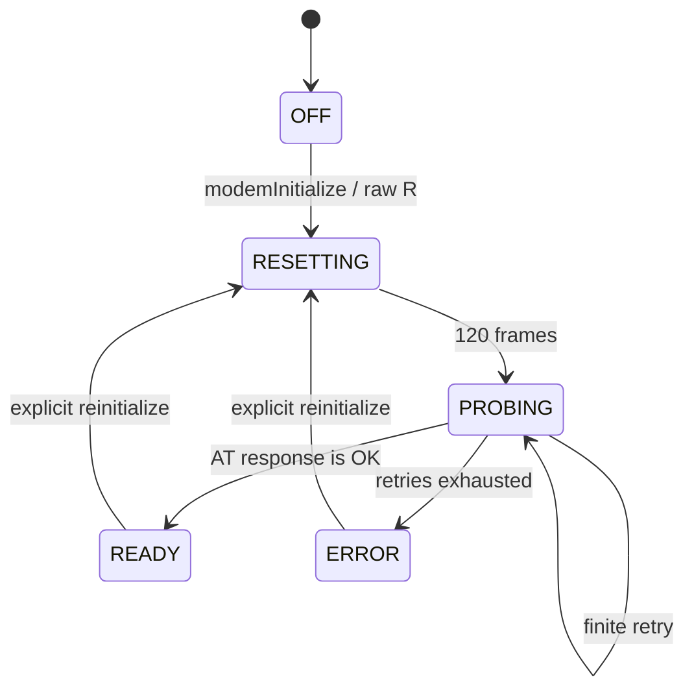

# NDM24 ドライバ設計

## 目的と範囲

この層は、SFC のコントローラーポート 2 に接続した NTT DATA NDM24 を、メインループから非同期に扱うためのものです。JRA PAT の観測結果を通信判定の基準とします。PPP へ渡せるバイト列を壊さないことを前提としますが、このマイルストーンには PPP 自体は含みません。

アセンブリの公開名は `modem*`、製品・プロトコルの名称は NDM24 に統一します。

## 所有権とスケジューリング

- NMI/VBlank は 32 ビットのフレームカウンタを更新し、コントローラーとモデムの処理要求を立てるだけです。
- コントローラーの手動読み取り、メールボックス、NDM24 I/O、AT セッションはメインループだけが実行します。
- SFC の自動ジョイパッド読み取りは無効です。コントローラーポート 2 を NMI が途中で触らないためです。
- bit-bang の転送間隔を NMI の処理時間で引き延ばさないよう、初期化、1 回の上限付き poll、手動コントローラー読み取りの間だけ NMI を保留し、終了時に元の状態へ戻します。
- ドライバは再入可能ではありません。同じ API を割り込みとメインループから同時に呼びません。
- 1 回の `modemPoll` は最大 32 回の 9 ビット転送で戻ります。残件があれば次のメインループで継続します。

## 公開 API

| API | 呼び出し規約 | 用途 |
|---|---|---|
| `modemInitializeDiagnostics` | A/X/Y 8 bit | 起動時に一度だけ診断 ABI とメールボックスを初期化 |
| `modemInitialize` | A/X/Y 16 bit | NDM24 固有初期化を開始し `RESETTING` へ遷移 |
| `modemPoll` | A/X/Y 16 bit | 状態確認と上限付き全二重転送 |
| `modemSessionPoll` | A/X/Y 16 bit | `AT` プローブの送信、行応答、タイムアウトを処理 |
| `modemQueueByte` | A/X/Y 8 bit、入力 A=byte | TX リングへ追加。成功 Carry clear、満杯 Carry set |
| `modemReadByte` | A/X/Y 8 bit | RX リングから取得。成功 Carry clear と A=byte、空 Carry set |
| `modemMailboxPoll` | A/X/Y 16 bit | QUsb2Snes から受けたテスト命令を処理 |

RX/TX はそれぞれ 256 バイトを確保し、read index と write index の一致を空状態に予約するため、実容量は 255 バイトです。送受信量、破棄、オーバーフロー、タイムアウトなどのカウンタは 32 ビットです。

## 初期化状態

`R` (`$52`) は AT コマンドではなく、NDM24 固有の初期化バイトとして扱います。送信後は 120 フレーム待ち、`AT CR LF` を送ります。echo は無視し、空行と CR/LF の差を許容して `OK` を認識します。`ERROR` または 300 フレームのタイムアウトは最大 3 回まで再試行し、その後 `ERROR` に固定します。エラー時は原因を保持するためトレースを自動凍結します。

AT 行パーサーには `OK`、`ERROR`、`BUSY`、`CONNECT...`、`NO CARRIER`、`NO DIALTONE` の認識を残しています。現段階では初期 `AT` プローブ中だけパーサーが RX を所有し、`READY` へ遷移した直後の残りのバイトは上位層へ残します。将来 PPP データを行パーサーが消費しないための境界です。

## 受信判定

完全な 16 ビット読み取りは、状態・識別の観測だけに使い、内部に見えるデータを RX キューへ渡しません。

9 ビット転送では、次の両方が成立した場合だけ `Data1` のバイトを受理します。

1. `Data2` の ready ビット（正規化後の上位バイト mask `$40`）
2. `Data1` の RX-present ビット（正規化後の下位バイト mask `$80`）

どちらかが欠けた候補は破棄します。これにより、ready が落ちている間や RX-present がない間に直前のバイトが繰り返し見える現象をアプリケーションへ渡しません。詳細な根拠は [JRA PAT の観測結果](jra-pat-observations.md)にあります。

## 常設診断

デバッグ機能はリリース種別で外さず、常に WRAM に置きます。

- 128 バイトの versioned diagnostic block
- 16 バイト × 256 件 = 4 KiB の循環トレース
- 64 バイトの QUsb2Snes 制御メールボックス
- 256 バイトずつの RX/TX リング

診断ブロックは sequence lock 方式です。ホストは偶数の `snapshot_sequence` を確認し、ブロックを再読して同じ値である場合だけ一貫したスナップショットとして使います。ただし、NMI が立てる advisory な `poll_tick` だけはこの sequence の対象外です。レイアウトの正本は `spec/ndm24.toml`、生成された表は [diagnostic-abi.md](generated/diagnostic-abi.md)です。

トレースは poll16、transfer9、RX accept/discard、TX、状態遷移、エラーを記録します。リングが一周した回数は診断カウンタへ残り、エラーイベント後は自動凍結します。QUsb2Snes メールボックスから消去、手動凍結、再開が可能です。

## JRA PAT プロファイルとの分離

JRA PAT で観測したモデム設定列は [`profiles/jra-pat.toml`](../profiles/jra-pat.toml)へ分離しています。ドライバ初期化が暗黙に JRA PAT 固有設定や電話番号を送ることはありません。これにより、Nifty 接続用プロファイルと再利用可能な NDM24 transport を分離します。
