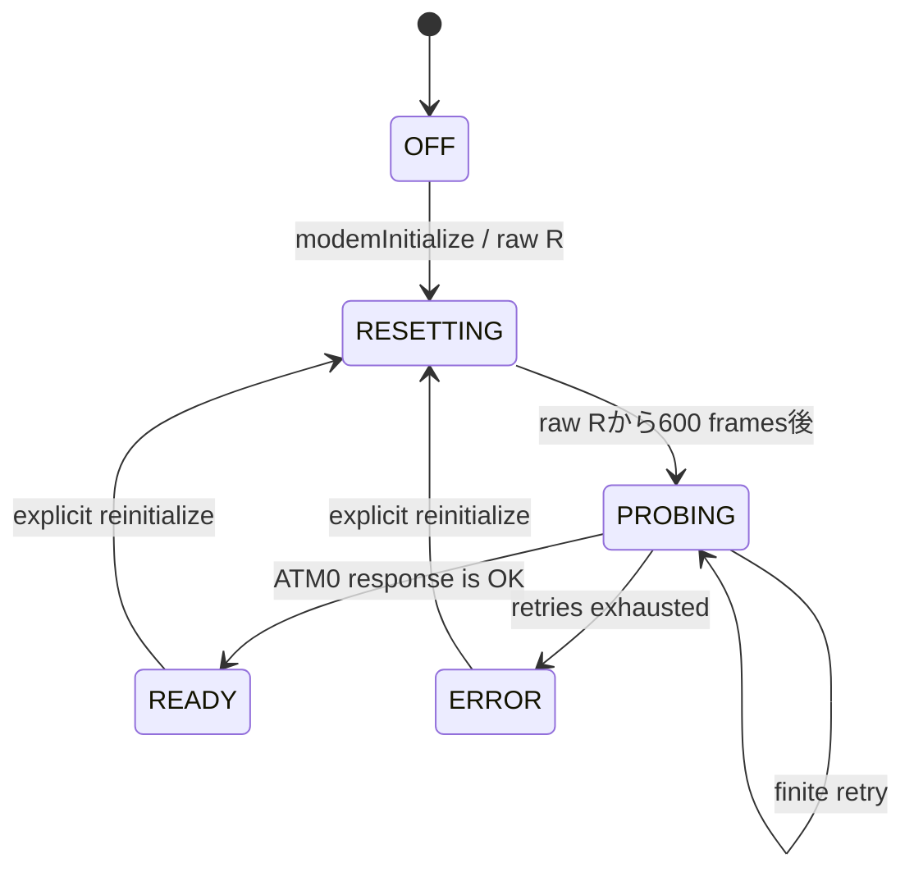

# NDM24 ドライバ設計

## 目的と範囲

この層は、SFC のコントローラーポート 2 に接続した NTT DATA NDM24 を、メインループから非同期に扱うためのものです。JRA PAT の観測結果を通信判定の基準とします。PPP へ渡せるバイト列を壊さないことを前提としますが、このマイルストーンには PPP 自体は含みません。

アセンブリの公開名は `modem*`、製品・プロトコルの名称は NDM24 に統一します。

## 所有権とスケジューリング

- NMI/VBlank は 32 ビットのフレームカウンタを更新し、コントローラーとモデムの処理要求を立てるだけです。
- コントローラーの手動読み取り、メールボックス、NDM24 I/O、AT セッションはメインループだけが実行します。
- SFC の自動ジョイパッド読み取りは無効です。コントローラーポート 2 を NMI が途中で触らないためです。
- bit-bang の転送間隔を NMI の処理時間で引き延ばさないよう、write-onlyの `$4200` (`NMITIMEN`) をWRAMの `nmitimenShadow` で管理します。初期化のraw `R`波形、1回の上限付きpoll、手動コントローラー読み取りでは現在値をstackへ退避してNMI enableを解除し、波形終了後に同じ値を復元します。`SEI` はmask可能IRQだけを保護し、NMI保護としては扱いません。
- VBlank中にNMI enableを0から1へ戻すと即時にNMIが再発火し得るため、無効化前と復元前には `$4212` (`HVBJOY`) のbit 7が0、すなわち表示期間へ戻ったことを確認します。これにより波形を現行VBlankの後へ配置し、復元時のNMI再発火ループも防ぎます。
- ドライバは再入可能ではありません。同じ API を割り込みとメインループから同時に呼びません。
- 1 回の `modemPoll` は最大 32 回の 9 ビット転送で戻ります。残件があれば次のメインループで継続します。

## 公開 API

| API | 呼び出し規約 | 用途 |
|---|---|---|
| `modemInitializeDiagnostics` | A/X/Y 8 bit | 起動時に一度だけ診断 ABI とメールボックスを初期化 |
| `modemInitialize` | A/X/Y 16 bit | NDM24 固有初期化を開始し `RESETTING` へ遷移 |
| `modemPoll` | A/X/Y 16 bit | 状態確認と上限付き全二重転送 |
| `modemSessionPoll` | A/X/Y 16 bit | `ATM0` プローブの送信、行応答、タイムアウトを処理 |
| `modemQueueByte` | A/X/Y 8 bit、入力 A=byte | TX リングへ追加。成功 Carry clear、満杯 Carry set |
| `modemReadByte` | A/X/Y 8 bit | RX リングから取得。成功 Carry clear と A=byte、空 Carry set |
| `modemMailboxPoll` | A/X/Y 16 bit | QUsb2Snes から受けたテスト命令を処理 |

RX/TX はそれぞれ 256 バイトを確保し、read index と write index の一致を空状態に予約するため、実容量は 255 バイトです。送受信量、破棄、オーバーフロー、タイムアウトなどのカウンタは 32 ビットです。

受理されたRXバイトは、通信RXリングへ保存すると同時に独立した表示ミラーへ複製されます。AT解析器が初期echoや`OK`を消費してもターミナル表示から失われず、表示側が遅延・overflowしても通信RXや将来のPPP入力には影響しません。詳細は [32文字幅ターミナル](terminal.md)を参照してください。

## 初期化状態

SFC起動時の `$4201` は、全programmable I/O出力をreleaseする `$FF` で初期化します。ロジックアナライザで観測したJRA PATのLow→Highは現時点では再現せず、NDM24固有の初期化は後続の `R` 専用シーケンスで行います。`modemInitialize` 内でもLow→Highは繰り返しません。

SFC起動中の `$4200` は0で、通常運転へ入る直前にNMI enableだけを立てた `$80` と、その値を `nmitimenShadow` へ同時に設定します。bit-bang区間が通常運転前や既にNMI無効の文脈から呼ばれても、終了時に無条件で `$80` を書かず、呼び出し前の値へ戻します。これにより起動時のraw `R`がNMIを予定より早く有効化することもありません。

`R` (`$52`) は AT コマンドではなく、NDM24 固有の初期化バイトとして扱います。raw `R` 後は600フレーム（NTSCで約10秒）待ってから `ATM0 CR LF` を送ります。`M0` はスピーカーを常時無効にする設定で、電源再投入や `AT&F` で失われるため、起動時と明示的な再初期化時のprobeに含めます。疑似PSTN試験でも `AT&F` の直後に再度 `ATM0` を送ります。1フレーム待機では300フレームのtimeoutを2回消費し、約10秒後の3回目だけが成功しました。600フレーム待機では最初のprobeで `OK` を受信し、timeout 0を実機確認済みです。`ERROR` または300フレームのタイムアウトは最大3回まで再試行し、その後 `ERROR` に固定します。エラー時は原因を保持するためトレースを自動凍結します。

`R` の直前は、過去の実機動作済み実装と同じく、latch後に16回の `JOYSER1` dummy readを連続して行います。この最初のレポートは診断値へ組み立てず、次の通常pollで完全なレポートを記録します。`R` の8データビットも通常の9-bit転送とは別の専用経路で送り、byteをstack上で `ROL`、carryを `ROR` で `$4201` bit 7へ移し、追加NOPを挟まず直後に `JOYSER1` を読みます。この波形で電源ランプの点滅を実機確認済みです。

AT 行パーサーには `OK`、`ERROR`、`BUSY`、`CONNECT...`、`NO CARRIER`、`NO DIALTONE` の認識を残しています。コマンドechoは結果として扱わず、行終端を受信した `OK` で `READY` へ遷移します。現段階では初期 `ATM0` プローブ中だけパーサーが RX を所有し、`READY` へ遷移した直後の残りのバイトは上位層へ残します。将来 PPP データを行パーサーが消費しないための境界です。

メールボックスの `at_transaction` は、最大28byteの送信列、期待する結果コード、16bitのframe timeoutを受け取る汎用ATコマンド実行器です。トランザクション実行中だけ行パーサーがRX ringを所有し、期待した `OK`、`CONNECT...`、`NO CARRIER` の末尾LFまで消費すると完了します。`CONNECT` 完了後は `CONNECTED` としてパーサーを停止するため、将来のbinary/PPP層へ受信所有権を渡せます。接続確認モードではpayloadを送らず、別の空トランザクションで `NO CARRIER` を待ちます。

期待結果コード0は識別情報照会専用のwildcardです。`OK`、`ERROR`など実際に受けた終端結果をmailbox resultへ返し、未対応の読み取り専用コマンドでもドライバを `ERROR` 状態にしません。接続や切断を伴う通常のtransactionは従来どおり期待結果を明示し、不一致を失敗として扱います。

mailbox ABI version 6の `binary_transmit` と `binary_receive` はraw byte転送用です。`binary_transmit` は `CONNECTED` 中に限り、入力arguments先頭のlengthと、それに続く最大31byteを空のTX ringへqueueし、受理数をresultへ返します。`binary_receive` は `CONNECTED` または `READY` でRX ringから最大31byteをSFC専用のoutputへ取り出し、取得数をresultへ返します。`READY` での利用は識別照会の終端後に遅れて到着したbyteの診断的drainに限定します。AT行パーサーを通さないため `0x00`、CR、LF、`0xFF` も同じデータとして扱います。PPP受信は通常無効であり、`ppp_receive_start` 後だけCONNECTED中のRX所有権がPPP層へ移ります。`ppp_receive_stop` でraw試験へ戻せます。

ABI version 6のデバッグ専用 `binary_stress_transmit` は、空のTX ringへ `0x00`～`0xFE` の255byteを一度にqueueします。main loopが `modemPoll`へ戻る前に使用可能容量全体を埋めるため、NDM24入力側のbackpressure、Data2変化、欠落・重複を最大burst条件で調べられます。

QUsb2Snesの `SETX` でホストが書いたWRAMと、同じ場所へSFCが書き戻す値は観測コピー上で安定しなかったため、96byte mailbox内の所有権を分離しています。arguments 32byteはホスト→SFC専用、output 32byteはSFC→ホスト専用で、逆方向からは書きません。ホストは `processed_sequence` と完了statusを見ただけでは結果を確定せず、96byteのmailbox全体が2回連続で一致してから制御結果を採用します。outputは別のQUsb2Snes接続から32byteだけを2回読み、一致した値を採用します。`host_sequence` は最後に書き、SFC側もoutputとresultの更新後に `processed_sequence` をcommitします。

## 受信判定

9-bit転送は、過去の実機動作済み実装と同じ命令順序にしています。latch後にTX queueを確認してTX Data Presentを出力し、16個のNOP後に最初の `JOYSER1` を読みます。続く8bitは、`$4201` への書き込み、`ASL`、`XBA`、8個のNOP、`JOYSER1` 読み取り、`XBA` の順です。タイミング区間にはsubroutine callを入れません。送信待ちがない場合の後続値は、動作済み実装と同じ `$80` です。

この命令列ではDBRをbank `$80` にします。これにより `$4201` をdirect absoluteでアクセスでき、同時にbank `$80:$0000-$1FFF` のWRAM mirrorを介してdriver stateと256-byte ringsへアクセスできます。したがって、この低レベル転送から参照するWRAMは先頭8KiB以内に置く必要があります。

TX queueのbyteは、TX Data Presentと8 data bitの波形を完了した直後にringから消費します。現時点でNDM24からのbyte単位ACKやCTS相当bitは特定できていないため、診断値の `tx_bytes` と `last_tx_byte` は「NDM24のcontroller interfaceへclockした」ことを表し、電話回線の相手へ到達したことまでは保証しません。

revision A/BのAT transactionでは、送信event時のData2は全件 `$0000` でした。両revisionのV.22bis接続中は、31byte burstを含む通常送信と255byte最大burstの全観測eventで `$0200` のまま変化せず、受信側のbyte列は完全一致しました。`$0200` は `CONNECT 2400` 応答の末尾で立ち、`CONNECTED` と切断待ちの間維持され、`NO CARRIER`直前に落ちるため、byte ACKではなくDCD相当のcarrier状態bitと推定します。両revisionの最大burstでもbackpressureは観測されなかったため、明示的な受理条件が判明するまでは波形完了時の消費を維持します。

完全な16ビット読み取りは状態・識別だけでなく、待機中の先頭RX byteを消費する場合があります。実機では汎用AT transactionの `AT&F` と `ATX3` の先頭 `A` がそれぞれ `Data1=$4183 / Data2=$4000` として16-bit pollに現れ、従来実装が破棄した結果、受信echoと画面表示が `T&F`、`TX3` になりました。Data2 hintを追加の受理条件にした試験では `ATDT0` の先頭 `A` がなお欠落したため、16-bit reportも9-bit reportと同様にData1のRX-presentだけを現在byteの受理条件とします。Data2は9-bit transferを開始するhintであり、現在byteの有効性判定には使いません。

9-bit transferで返された現在byteの受理条件は、`Data1` 下位byteのtransfer RX-present mask `$80` が1であることです。9-bit transfer中はData2を受理条件に使いません。

9-bit transferは先頭8サンプルをデータ、最後の9番目をRX-presentとして並べます。実機トレースでは有効な `A=$4180`、`T=$5480`、`CR=$0D80` などすべてでmask `$80` が1でした。このflagが0の候補だけを破棄します。

Data2 の `$40` は9-bit transferを開始するための暫定的なhintとしてだけ使います。送信バッファの空・非空を確定する信号とは扱いません。実機では `T=$5480` と結果コード末尾の `CR=$0D80` でData2が0になった直後にも、RX-presentが成立した次byteが返りました。

したがって、いったん9-bit受信を開始した後はData2にかかわらず、RX-presentが成立する間は連続転送します。RX-presentが不成立になった時点で停止し、次回はData2 hintまたは送信待ちを契機に再開します。詳細な根拠は [JRA PAT の観測結果](jra-pat-observations.md)にあります。

RX-present修正時の旧 `AT` probeによる実機smoke testでは、9byteの `AT CR CR LF OK CR LF` を受理しました。現在の `ATM0` probeでは11byteの `ATM0 CR CR LF OK CR LF` を受理し、送信6byte、timeout 0で `READY` へ遷移することを合格条件とします。ATセッションparserは最後のLFまで消費し、次の通信層のRX queueに残しません。

## 常設診断

デバッグ機能はリリース種別で外さず、常に WRAM に置きます。

- 128 バイトの versioned diagnostic block
- 16 バイト × 256 件 = 4 KiB の循環トレース
- 96 バイトの QUsb2Snes 制御メールボックス
- 256 バイトずつの RX/TX リング
- 256 バイトの表示ミラーリング

診断ブロックは sequence lock 方式です。ホストは偶数の `snapshot_sequence` を確認し、ブロックを再読して同じ値である場合だけ一貫したスナップショットとして使います。ただし、NMI が立てる advisory な `poll_tick` だけはこの sequence の対象外です。レイアウトの正本は `spec/ndm24.toml`、生成された表は [diagnostic-abi.md](generated/diagnostic-abi.md)です。

`poll_budget_yield` は、1回の `modemPoll` が32回の9-bit transferを完了してメインループへ処理を返した回数です。カウンタとsticky flagは正常な協調動作を観測する情報であり、エラーではありません。yield後はコントローラー、mailbox、session処理を各1回通り、次のメインループで `modemPoll` を直ちに再開します。AT transactionの停止は既存のframe timeout、ホスト試験中の停止は各待機timeoutで検出します。旧名 `poll_limit` から名称と判定だけを変更し、offset `$34`、カウンタ動作、診断binary ABI version 2は維持しています。

トレースは poll16、transfer9、RX accept/discard、TX、状態遷移、エラーを記録します。リングが一周した回数は診断カウンタへ残り、エラーイベント後は自動凍結します。QUsb2Snes メールボックスから消去、手動凍結、再開が可能です。

FXPAK PRO が公開する `$F50000` 以降のWRAM観測領域は読み取り用のコピーであり、通常の `PutAddress` では実WRAMを変更できません。ホストからの入力arguments、command、host sequenceは、`SETX` flagでNMI実行されるレジスタ保存付きの短い65816コードが実WRAMへ書き込みます。SFCからホストへのprocessed sequence、status、result、outputは観測領域を介して読みます。

リンクラベル `modemPollStage`、`modemSessionStage`、`modemMailboxStage` は常設の内部診断値です。`modemPollStage` は `0x10` を入口、`0x20` 台をpoll処理中、`0x30` を復帰直前とします。`modemSessionStage` は `0x10` を入口、`0x20` 台をprobe準備、`0x30` 台を受信、`0x40` をtimeout確認、`0x50` 台を `AT\r\n` のqueue処理、`0x90` を復帰直前とします。`modemMailboxStage` は `0x10` を入口、`0x20` をsequence確認、`0x30` を受付、`0x40` をcommit、`0x90` を復帰直前とします。メインループ停止時の位置をQUsb2Snesから特定するための値で、公開診断ABIには含めません。

`modemMailboxObservedHost` と `modemMailboxObservedProcessed` は、SFCがsequence比較時に実際に読んだ値を保持します。QUsb2Snesから見えるmailbox値とSFC側の読みが異なる場合のアドレス・DBR診断に使います。

8ビット幅で呼び出す内部ヘルパーは、直前のコードからアセンブラ状態を継承させず、入口で `.a8` と `.i8` を明示します。実行時幅と即値命令の機械語幅が異なると、余分な即値バイトが次の命令として実行されるためです。

`terminal_dropped` は、表示ミラーが満杯になり、最新表示を残すため最古の表示待ちバイトを捨てた回数です。この値が増えても通信RXの欠落を意味しません。

## JRA PAT プロファイルとの分離

JRA PAT で観測したモデム設定列は [`profiles/jra-pat.toml`](../profiles/jra-pat.toml)へ分離しています。ドライバ初期化が暗黙に JRA PAT 固有設定や電話番号を送ることはありません。これにより、Nifty 接続用プロファイルと再利用可能な NDM24 transport を分離します。
