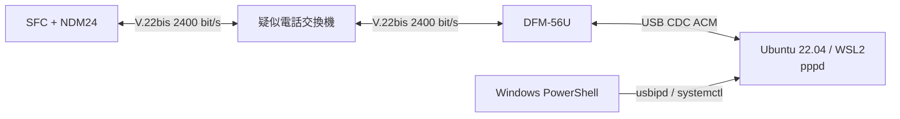

# WSL2 PPPサーバー

## 目的

疑似PSTNの相手側モデムとしてI/O DATA DFM-56Uを使い、WSL2上の
`pppd`をNTT DATA NDM24の対向にします。最初の試験範囲はLCPとPAP要求
optionまでです。SFC側にPAPを実装するまでは認証成功やIPCP到達を合格条件に
しません。



疑似電話交換機は閉じた試験環境だけに接続し、公衆電話網へ接続しません。

## 確認済み環境

2026-07-30に次の構成を確認しました。

- USB ID: `0572:1329`
- Windows名: `Conexant USB CX93010 ACF Modem`
- WSL2デバイス: `/dev/ttyACM0`
- Ubuntu: 22.04
- WSL kernel: `5.10.60.1-microsoft-standard-WSL2`
- `usbipd-win`: 5.3.0
- `pppd`: 2.4.9
- modem firmware: `CX93001-EIS_V0.2013-V92`
- `AT+GMI`: `CONEXANT`
- `AT+GMM`: `V90`

接続前にDTE側のRTS/CTSを有効にするとAT応答が停止しました。既存の
binary pattern試験と同じく、DFM-56Uへ`AT&K0`を送り、Linux側も
`nocrtscts`とします。USB DTE速度の115200 bit/sと、アナログ回線上の
V.22bis 2400 bit/sは別の速度です。

USB機器のattach方法は[MicrosoftのWSL USB手順](https://learn.microsoft.com/windows/wsl/connect-usb)
と[usbipd-win](https://github.com/dorssel/usbipd-win)に従います。この環境では
旧usbipd-winの`VBoxUsbMon` driverが欠けていたため、5.3.0への上書き更新で
修復しました。`usbipd attach`が同じdriver errorで失敗する場合は、先に
usbipd-winを修復または更新します。

## ファイル

- `tools/ppp-server/ndm24-answer.chat`: DFM-56U初期化、着信待ち、応答
- `tools/ppp-server/ndm24-lcp`: LCP試験用`pppd` peer profile
- `tools/ppp-server/ndm24-ppp-server.service`: 手動起動するsystemd service
- `tools/ppp-server/install-wsl.sh`: WSL側へのroot所有ファイルの導入
- `tools/ppp-server/ndm24-probe.chat`: 読み取り専用AT probeと応答検査
- `tools/ppp-server/probe-modem.sh`: 回線を使わないAT probe
- `tools/ppp-server/ndm24-ppp-server.ps1`: Windows側の統合操作

導入処理は既存の`/etc/ppp/pap-secrets`を置き換えません。NDM24用entryが
ない場合だけ、閉じた試験用の次の資格情報を追記します。

| 項目 | 値 |
|---|---|
| client | `ndm24` |
| server | `ndm24-server` |
| password | `ndm24-test` |
| peer address | `10.24.0.2` |

これは実サービスの資格情報ではありません。疑似PSTNの外では使用しません。
初回追記時には`/etc/ppp/pap-secrets.pre-ndm24`も作成します。

## 導入と回線を使わない確認

PowerShellから実行します。

```powershell
.\tools\ppp-server\ndm24-ppp-server.ps1 Install
.\tools\ppp-server\ndm24-ppp-server.ps1 Probe
.\tools\ppp-server\ndm24-ppp-server.ps1 Stop
```

`Install`は設定を`/etc/ppp`と`/etc/systemd/system`へ配置し、`pppd
dryrun`で全optionを検査します。serviceのenableやstartは行いません。

`Probe`はUSB IDからDFM-56Uの現在のBUSIDを見つけ、必要ならWSL2へ
attachして、`AT`、`ATI`、`ATI3`、`AT+GMI`、`AT+GMM`、`AT+GMR`を
照会します。発信、着信応答、回線接続は行いません。

`Stop`はserviceを停止してUSBIPをdetachし、DFM-56UがWindowsのCOMポート
へ再列挙されるまで最大10秒待ちます。USBIPのshareは永続ですが、attachは
WindowsやWSLの再起動、USBの抜き差し後に必要です。

## LCP接続試験

疑似電話交換機と両モデムの準備後、最初に対向serverを待受状態にします。

```powershell
.\tools\ppp-server\ndm24-ppp-server.ps1 Start
.\tools\ppp-server\ndm24-ppp-server.ps1 Status
.\tools\ppp-server\ndm24-ppp-server.ps1 Logs
```

`Start`はDFM-56UをWSL2へattachし、serviceを手動起動します。chat scriptは
DFM-56Uを初期化した後、最大300秒`RING`を待ち、`ATA`の後に`CONNECT`を
待ちます。自動再発信やserviceの自動再起動はしません。

DFM-56Uは次の条件へ固定します。

- `AT&D2`: DTR低下で切断
- `AT+MS=V22B,0,2400,2400,2400,2400`: V.22bis 2400 bit/s
- `AT&K0`: DTE flow control無効
- `ATM0`: speaker無効
- `ATS0=0`: chat scriptから`ATA`を送る手動応答

`pppd`はPAPを要求し、CHAP、MS-CHAP、EAP、PFC、ACFC、VJ、CCP、
BSD-Compress、Deflate、IPv6を無効にします。LCP Echo-Requestも無効です。

Ubuntuの`pppd`はpeer profileより前に`/etc/ppp/options`も読みます。確認した
環境には`passive`が設定されているため、Configure-Requestの規定回数を使い
切った後もpeerから有効なLCP packetが届くまで待機します。初回Requestと
3秒間隔の再送には影響しません。既存の用途を壊さないためglobal fileは変更
せず、試験終了時に`Stop`を必ず実行します。globalの`crtscts`、`proxyarp`、
30秒のLCP echoはpeer profileの`nocrtscts`、`noproxyarp`、
`lcp-echo-interval 0`で上書きします。globalのDNS指定はIPCP段階へ進む前に
別途整理します。

初回試験ではSFC側が次を満たすことを確認します。

1. 双方がV.22bisで`CONNECT`する。
2. SFCと`pppd`がConfigure-Requestを送信する。
3. SFCがMRU、ACCM、PAP、Magic-Numberを含むpeer Requestへ正しく応答する。
4. 双方のConfigure-Ack後にSFC診断状態が`Opened`になる。
5. `pppd`がPAP待ちへ進み、未実装のSFC側PAPによって認証完了しない。
6. 切断後にSFC側LCPが`Closed`へ戻り、timerとpending送信を残さない。

SFC側の発信と切断結果待ちは、期待するresult codeを明示します。

```powershell
cargo run -p ndm24-tools -- at ATDT0 --expect connect --timeout-frames 3900 --timeout-seconds 75
cargo run -p ndm24-tools -- at "" --expect no-carrier --timeout-frames 900 --timeout-seconds 20
```

`timeout-frames`はSFC側のVBlank基準、`timeout-seconds`はPC側メールボックス
待機の上限です。前者が必ず先に成立するようPC側を長く設定します。

SFCの診断は別のPowerShellで取得します。

```powershell
cargo run -p ndm24-tools -- ppp-monitor
cargo run -p ndm24-tools -- trace-live
```

対向ログは`Logs` actionと、WSL内の`/var/log/ndm24-pppd.log`へ残ります。
`debug`はLCPなどの制御packetを記録しますが、`show-password`は設定せず、
PAP passwordをログへ出しません。

試験終了時は必ず停止します。

```powershell
.\tools\ppp-server\ndm24-ppp-server.ps1 Stop
```
