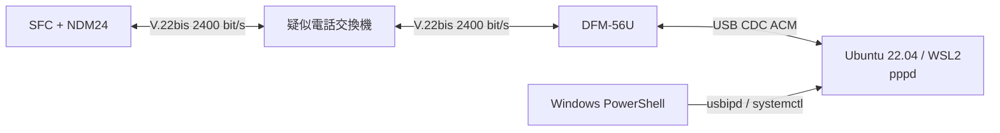

# WSL2 PPPサーバー

## 目的

疑似PSTNの相手側モデムとしてI/O DATA DFM-56Uを使い、WSL2上の
`pppd`をNTT DATA NDM24の対向にします。revision AではLCP `Opened`、
閉じたfixture資格情報によるPAP Authenticate-Request/Ack、IPCP `Opened`
まで確認済みです。SFC側local `10.24.0.2`、peer `10.24.0.1`の確定と、
切断後の各層の初期化も合格しています。



疑似電話交換機は閉じた試験環境だけに接続し、公衆電話網へ接続しません。

## 確認済み環境

2026-07-30に次の構成を確認しました。

- USB ID: `0572:1329`
- Windows名: `Conexant USB CX93010 ACF Modem`
- WSL2デバイス: `/dev/ttyACM0`
- Ubuntu: 22.04
- WSL kernel: `5.10.60.1-microsoft-standard-WSL2`
- `usbipd-win`: 5.3.0
- `pppd`: 2.4.9
- modem firmware: `CX93001-EIS_V0.2013-V92`
- `AT+GMI`: `CONEXANT`
- `AT+GMM`: `V90`

接続前にDTE側のRTS/CTSを有効にするとAT応答が停止しました。既存の
binary pattern試験と同じく、DFM-56Uへ`AT&K0`を送り、Linux側も
`nocrtscts`とします。USB DTE速度の115200 bit/sと、アナログ回線上の
V.22bis 2400 bit/sは別の速度です。

USB機器のattach方法は[MicrosoftのWSL USB手順](https://learn.microsoft.com/windows/wsl/connect-usb)
と[usbipd-win](https://github.com/dorssel/usbipd-win)に従います。この環境では
旧usbipd-winの`VBoxUsbMon` driverが欠けていたため、5.3.0への上書き更新で
修復しました。`usbipd attach`が同じdriver errorで失敗する場合は、先に
usbipd-winを修復または更新します。

## ファイル

- `tools/ppp-server/ndm24-answer.chat`: DFM-56U初期化、着信待ち、応答
- `tools/ppp-server/ndm24-lcp`: LCP試験用`pppd` peer profile
- `tools/ppp-server/ndm24-ppp-server.service`: 手動起動するsystemd service
- `tools/ppp-server/install-wsl.sh`: WSL側へのroot所有ファイルの導入
- `tools/ppp-server/ndm24-probe.chat`: 読み取り専用AT probeと応答検査
- `tools/ppp-server/probe-modem.sh`: 回線を使わないAT probe
- `tools/ppp-server/ndm24-ppp-server.ps1`: Windows側の統合操作

導入処理は既存の`/etc/ppp/pap-secrets`を置き換えません。NDM24用entryが
ない場合だけ、閉じた試験用の次の資格情報を追記します。

| 項目 | 値 |
|---|---|
| client | `ndm24` |
| server | `ndm24-server` |
| password | `ndm24-test` |
| peer address | `10.24.0.2` |

これは実サービスの資格情報ではありません。疑似PSTNの外では使用しません。
初回追記時には`/etc/ppp/pap-secrets.pre-ndm24`も作成します。

## 導入と回線を使わない確認

PowerShellから実行します。

```powershell
.\tools\ppp-server\ndm24-ppp-server.ps1 Install
.\tools\ppp-server\ndm24-ppp-server.ps1 Probe
.\tools\ppp-server\ndm24-ppp-server.ps1 Stop
```

`Install`は設定を`/etc/ppp`と`/etc/systemd/system`へ配置し、`pppd
dryrun`で全optionを検査します。DFM-56UがWindows側にあり、
`/dev/ttyACM0`が存在しない状態でも実行できます。serviceのenableやstartは
行いません。

`Probe`はUSB IDからDFM-56Uの現在のBUSIDを見つけ、必要ならWSL2へ
attachして、`AT`、`ATI`、`ATI3`、`AT+GMI`、`AT+GMM`、`AT+GMR`を
照会します。発信、着信応答、回線接続は行いません。

`Stop`はserviceを停止してUSBIPをdetachし、DFM-56UがWindowsのCOMポート
へ再列挙されるまで最大10秒待ちます。USBIPのshareは永続ですが、attachは
WindowsやWSLの再起動、USBの抜き差し後に必要です。

確認したWSL環境には、以前のシリアルログイン用`mgetty.service`もあり、
`Restart=always`で同じ`ttyACM0`を取得していました。この用途は終了したため、
`Install`はmgettyを停止して自動起動も無効化します。`Probe`と`Start`も、
古い導入状態から直接実行して安全に移行できるよう同じ無効化を行います。
設定ファイルは削除しません。

## PPP接続試験

疑似電話交換機と両モデムの準備後、最初に対向serverを待受状態にします。

```powershell
.\tools\ppp-server\ndm24-ppp-server.ps1 Start
.\tools\ppp-server\ndm24-ppp-server.ps1 Status
.\tools\ppp-server\ndm24-ppp-server.ps1 Logs
```

`Start`はDFM-56UをWSL2へattachし、serviceを手動起動します。chat scriptは
DFM-56Uを初期化した後、最大300秒`RING`を待ち、`ATA`の後に`CONNECT`を
待ちます。自動再発信やserviceの自動再起動はしません。

DFM-56Uは次の条件へ固定します。

- `AT&D2`: DTR低下で切断
- `AT+MS=V22B,0,2400,2400,2400,2400`: V.22bis 2400 bit/s
- `AT&K0`: DTE flow control無効
- `ATM0`: speaker無効
- `ATS0=0`: chat scriptから`ATA`を送る手動応答

`pppd`はPAPを要求し、CHAP、MS-CHAP、EAP、PFC、ACFC、VJ、CCP、
BSD-Compress、Deflate、IPv6を無効にします。LCP Echo-Requestも無効です。
SFC側のLCP診断と切断試験を行う時間を確保するため、PAP Authenticate-Request
の待ち時間は120秒です。PAP実装後も、回線上の再試験や診断取得に余裕を持た
せるためこの値を維持します。

Ubuntuの`pppd`はpeer profileより前に`/etc/ppp/options`も読みます。確認した
環境には`passive`が設定されているため、Configure-Requestの規定回数を使い
切った後もpeerから有効なLCP packetが届くまで待機します。初回Requestと
3秒間隔の再送には影響しません。既存の用途を壊さないためglobal fileは変更
せず、試験終了時に`Stop`を必ず実行します。globalの`crtscts`、`proxyarp`、
30秒のLCP echoはpeer profileの`nocrtscts`、`noproxyarp`、
`lcp-echo-interval 0`で上書きします。globalのDNS指定はIPCP段階へ進む前に
別途整理します。

初回試験ではSFC側が次を満たすことを確認します。

1. 双方がV.22bisで`CONNECT`する。
2. SFCと`pppd`がConfigure-Requestを送信する。
3. SFCがMRU、ACCM、PAP、Magic-Numberを含むpeer Requestへ正しく応答する。
4. 双方のConfigure-Ack後にSFC診断状態が`Opened`になる。
5. `pppd`がSFCのPAP Authenticate-Requestを受理し、Authenticate-Ackを返す。
6. SFC側のPAP stateが`Opened`へ到達し、再送timerが停止する。
7. IPCP双方のConfigure-Request/Ack/Nakを経て、SFC側IPCPが`Opened`になる。
8. SFC診断でlocal `10.24.0.2`、peer `10.24.0.1`が確定し、timerが停止する。
9. PAP payloadやpasswordが通常ログへ出ない。
10. 切断後にSFC側LCPとIPCPが`Closed`、PAPが`Inactive`へ戻り、timerとpending送信を残さない。

PPP受信は発信前に有効化します。`CONNECT`後に有効化すると、対向が先に送った
LCP frameの途中からdecoderへ渡され、FCS errorやRX ring overflowを生じる
可能性があります。NDM24の電源投入やraw `R`による起動時probeは回線設定を
V.22bisへ固定しません。発呼のたびに次の設定列を適用します。`AT&F`は以前の
設定を既定値へ戻すため、speakerを無効化する`ATM0`を必ずその直後に送ります。

```powershell
cargo run -p ndm24-tools -- at 'AT&F' --expect ok --timeout-frames 300 --timeout-seconds 15
cargo run -p ndm24-tools -- at ATM0 --expect ok --timeout-frames 300 --timeout-seconds 15
cargo run -p ndm24-tools -- at 'AT%B2400' --expect ok --timeout-frames 300 --timeout-seconds 15
cargo run -p ndm24-tools -- at ATS7=60 --expect ok --timeout-frames 300 --timeout-seconds 15
cargo run -p ndm24-tools -- at ATX3 --expect ok --timeout-frames 300 --timeout-seconds 15
cargo run -p ndm24-tools -- mailbox ppp-receive-start
cargo run -p ndm24-tools -- at ATDT0 --expect connect --timeout-frames 3900 --timeout-seconds 75
```

`timeout-frames`はSFC側のVBlank基準、`timeout-seconds`はPC側メールボックス
待機の上限です。前者が必ず先に成立するようPC側を長く設定します。切断時は
`Stop`で対向を停止し、PPP受信層がpeerのTerminate-Requestとraw
`NO CARRIER`を処理した後、診断と`pending-rx`を確認します。

SFCの診断は別のPowerShellで取得します。

```powershell
cargo run -p ndm24-tools -- ppp-monitor
cargo run -p ndm24-tools -- trace-live
```

対向ログは`Logs` actionと、WSL内の`/var/log/ndm24-pppd.log`へ残ります。
`debug`はLCPなどの制御packetを記録しますが、`show-password`は設定せず、
PAP passwordをログへ出しません。

## 2026-07-30 revision A 初回結果

revision AのNDM24とDFM-56UをV.22bis 2400 bit/sで接続し、最初の実回線LCP
交渉を行いました。SFC診断と`pppd`ログの双方で次を確認しています。

- SFCは空optionのConfigure-Request（Identifier 0）を送信した。
- `pppd`はACCM 0、PAP、Magic-Numberを含むConfigure-Requestを送信した。
- SFCはpeer RequestをConfigure-Ackし、peer optionを確定した。
- `pppd`はSFC RequestをConfigure-Ackした。
- SFCは受信2frame、送信2frame、FCS error 0、invalid 0で`Opened`へ到達した。
- 確定したpeer MRUは1500、ACCMは0、Magic-Numberは`0x4900EFB9`だった。

この結果によりLCP確立部分は合格とします。一方、SFC側PAPが未実装のため、
当時の30秒PAP待ちが切れると`pppd`がTerminate-Requestを送り、回線を切断
しました。PPP decoderがRXを所有したままNDM24の`NO CARRIER`を消費したため、
後から開始したAT result待ちはtimeoutし、明示的な再初期化が必要でした。
切断境界でFCS errorも1回記録されています。この問題はLCP確立中の欠損では
ありませんが、この時点の正常切断の合格条件は未達です。その後、PPP所有中
にもraw `NO CARRIER` result lineを識別し、自動で`Ready`とLCP `Closed`へ
戻す処理を追加しました。同じ切断で連続した2行目も次のAT transactionへ
残さないよう、同じRX burstの末尾を消費して診断counterへ記録します。以後の
再試験時間を確保するためPAP待ちも120秒へ延長しています。

同日の修正版再試験では、再び双方のConfigure-Request/AckとSFC側`Opened`を
確認した後、PPP受信所有権を維持したまま`pppd`を停止しました。結果は次の
とおりで、正常切断の合格条件も満たしました。

- peerの2回のTerminate-RequestをFCS error 0で受信した。
- 最初のraw `NO CARRIER\r\n`で`carrier_loss_count`が1になった。
- 同じRX burstに続いた2行目の12byteを`carrier_tail_byte_count`へ記録した。
- Modemは`Ready`、LCPは`Closed`となり、timer、peer option、pending送信は
  すべて初期化された。
- RX read/write indexは239/239で一致し、`pending-rx`の結果は空配列だった。
- 切断直後の新しい`AT` transactionも`OK`で完了し、timeout、overflow、
  discardは0だった。

## 2026-07-30 revision A PAP認証結果

PAP client実装後、同じrevision AのNDM24とDFM-56UをV.22bis
2400 bit/sで再接続しました。`pppd`ログとPPP診断ABI version 5を照合し、
次を確認しました。

- LCPは双方2frameで`Opened`となり、peer flagsはACCM、PAP、
  Magic-Numberの`14`、peer MRUは1500、ACCMは0だった。
- SFCはPeer-ID `ndm24`のAuthenticate-RequestをIdentifier 1で1回送信した。
- `pppd`はAuthenticate-Ack Identifier 1、Message `"Login ok"`を返し、
  `PAP peer authentication succeeded for ndm24`を記録した。
- `pppd`ログ上のpasswordは`<hidden>`であり、SFC診断にもcredential payloadは
  保存されていない。
- SFCのPAP stateは`Opened`、最後のCodeはAuthenticate-Ack、packet Lengthは
  13、送受信数は各1、restart残数9、timer無効、failure 0だった。
- この時点のPPP全体は受信6frame、送信3frame、FCS error、invalid、
  overflow、TX backpressureがすべて0だった。
- 認証後、`pppd`はIPCP Configure-Requestで`10.24.0.1`を提案した。当時は
  SFC側IPCPが未実装だったため、このpacketはprotocol dispatcherが解放した。
  この記録はIPCP実装前のbaselineとして保持する。

対向停止後はpeerのTerminate-Requestを受信し、raw `NO CARRIER`でModemが
`Ready`へ戻りました。LCPは`Closed`、PAPは`Inactive`となり、双方のtimer、
pending action、peer optionは初期化されました。`carrier_loss_count`は1、
同じRX burstの末尾12byteも従来どおり消費され、RX read/write indexは
210/210、`pending-rx`は空配列でした。FCS errorとinvalidは最後まで0です。
DFM-56UはWindowsのCOM5へ正常に戻っています。

## 2026-07-30 revision A IPCP結果

PPP受信を発信前に有効化し、revision AのNDM24とDFM-56UをV.22bis
2400 bit/sで再接続しました。SFC診断ABI version 6、`pppd`ログ、
WSL2の`ppp0`を照合し、次を確認しました。

- LCPはpeer Request/Ackを各1回受信して`Opened`となり、PAPは
  Authenticate-Request/Ack各1回で`Opened`となった。
- SFCはIPCP Configure-Request Identifier 1で`0.0.0.0`を要求し、
  `pppd`のConfigure-Nakで提案された`10.24.0.2`を採用した。
- SFCはIdentifier 2で`10.24.0.2`を再要求し、Configure-Ackを受信した。
- `pppd`の`10.24.0.1`要求へSFCがConfigure-Ackを返し、SFC側IPCPは
  `Opened`、local `10.24.0.2`、peer `10.24.0.1`となった。
- WSL2の`ppp0`はlocal `10.24.0.1`、peer `10.24.0.2`で`UP`となった。
- IPCP送受信数は各3、PPP受信frame数は6だった。FCS error、invalid、
  overflow、drain budget yield、TX backpressure、TX abortはすべて0だった。
- `pppd`ログのPAP passwordは従来どおり`<hidden>`だった。

`Stop`後はpeerのTerminate-Requestを2回受信し、raw `NO CARRIER`を1回検出
しました。LCPとIPCPは`Closed`、PAPは`Inactive`へ戻り、local address、
timer、pending/deferred送信は初期化されました。切断後のFCS error、
invalid、overflowは0、同じRX burstの末尾12byteは既存仕様どおり消費され、
`pending-rx`は空でした。DFM-56UもWindowsのCOM5へ正常に戻っています。

## 2026-07-30 revision A IPv4/ICMP Echo結果

IPCP確立後、WSL2の`ppp0`からSFCへ次を実行し、疑似PSTN上で最初のIPv4 packet
送受信を確認しました。

```bash
ping -c 4 -W 5 10.24.0.2
ping -c 1 -W 6 -s 0 10.24.0.2
ping -c 1 -W 6 -s 1 10.24.0.2
ping -c 1 -W 6 -s 17 10.24.0.2
ping -c 1 -W 6 -s 127 10.24.0.2
```

- 標準56byte payloadは4送信/4応答、packet loss 0%、平均RTT
  1274.690 msだった。
- 0、1、17、127byte payloadも各1回応答し、偶数長と奇数長の両方に合格した。
- SFC診断のIPv4受信/受理/送信は8/8/8、ICMP Echo Request受信/ICMP送信は
  8/8だった。
- PPP受信frameは14、送信frameは17、FCS error、invalid、overflow、
  backpressure、abortはすべて0だった。
- IPv4 checksum error/dropとICMP checksum error/dropもすべて0だった。
- 最後の127byte payloadではIPv4 total length 155、ICMP payload length
  127を記録し、Echo Replyを正常に返した。

この試験の直前、SFC再起動後に起動時probeだけで`ATDT0`を送った2回は、対向
DFM-56Uが`RING`を受けて`ATA`を送った後に`NO CARRIER`となりました。
`AT&F`、`ATM0`、`AT%B2400`、`ATS7=60`、`ATX3`の合格済み設定列を再適用すると
約18秒で`CONNECT`しました。したがって発呼前設定列は電源状態に依存させず、
毎回適用する試験前提とします。

試験終了時は必ず停止します。

```powershell
.\tools\ppp-server\ndm24-ppp-server.ps1 Stop
```
