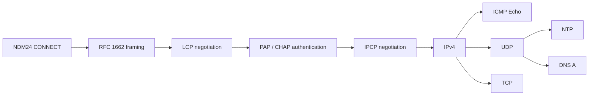

# PPP 実装方針

## 現在の範囲

最初のPPPマイルストーンは、NDM24から受け取る任意位置で分割されたbyte列を、FCS検証済みのPPPフレームへ復元する層です。`crates/ndm24-ppp` を仕様の参照実装とし、同じ状態遷移と試験ベクトルを65816へ移植しています。

現時点ではRFC 1662の非同期HDLC-like framingに加え、65816版LCP、PAP/CHAP-MD5 client、IPCP、IPv4 packet層、ICMP Echo responder/requester、UDP datagram層、NTP client、最小DNS A clientまで実装済みです。受信FCS検証、unescape、Flag境界、最大長判定、再同期、送信FCS付加、escapeはNDM24のRX/TXリングへ上限付きで接続しています。2026-07-30にrevision AとWSL2 `pppd`の実対向でLCP `Opened`、PAP Authenticate-Request/Ack、IPCP `Opened`まで確認し、SFC側`10.24.0.2`と対向`10.24.0.1`を確定しました。同日にIPv4、ICMP Echo、UDP/NTP/DNSはMesenCE、FXPAK PRO実機、疑似PSTNのV.22bis 2400 bit/s回線上で送受信に合格しました。さらにWSL2のNATを介し、SFC実機から公開IPv4 `1.1.1.1`へのICMP Echo往復と公開DNS問い合わせにも合格しています。NTPでは2回連続で相関済み応答からUnix秒を取得しています。2026-07-31にはrevision AのNDM24からNiftyへ実回線発信し、CHAP-MD5認証、IPCP、IPCPで得たDNSを使う公開DNS問い合わせ、正常切断まで合格しました。割当public IPと認証情報は記録していません。TCPは未実装です。

PPP接続は次の順序で進みます。



LCPでlinkを確立し、必要なら認証を行い、その後IPCPでIPv4を有効にする順序は [RFC 1661](https://www.rfc-editor.org/rfc/rfc1661.html) と [RFC 1332](https://www.rfc-editor.org/rfc/rfc1332.html) に従います。

## 非同期フレーミング

初期実装はAddress/Control field compressionとProtocol field compressionを使わない標準形を扱います。

```text
Flag  Address  Control  Protocol  Information  FCS16  Flag
7E    FF       03       2 bytes   0..MRU       2 bytes 7E
```

- Flagは `$7E`。
- Control Escapeは `$7D`。escape後のbyteは `$20` とXORする。
- 送信側は最低でも `$7E` と `$7D` をescapeする。
- LCP交渉前のdefault ACCMは `$FFFFFFFF` とし、`$00`～`$1F` もescapeする。
- FCSはAddressからInformationまでを対象とする16bit FCSで、初期値は `$FFFF`。
- 送信時はFCSを反転し、下位byteから付加する。
- 受信時にFCSを含む列を計算した結果が `$F0B8` なら正常。
- FCS付加後にescapeし、受信側はunescapeとreceive ACCM除去をFCS検証前に行う。
- 連続Flagは空フレームとして無視する。
- 4byte未満、Flag直前がControl Escape、最大長超過はFCS errorとは別のinvalid/discardとして扱う。

これらは [RFC 1662](https://www.rfc-editor.org/rfc/rfc1662.html) section 3.1、4.1～4.3、Appendix C.2を基準とします。

空optionのLCP Configure-Requestを最初の固定試験ベクトルとします。

```text
unescaped, FCS included:
FF 03 C0 21 01 01 00 04 D1 B5

default ACCM, Flags included:
7E FF 7D 23 C0 21 7D 21 7D 21 7D 20 7D 24 D1 B5 7E
```

Rust参照実装は全入力分割位置、破損FCSからの再同期、Flag直前のescape、receive ACCMによる注入control文字の除去、最大長超過、default MRU 1500byteを試験します。送信側の `AsyncEncoder` は次のwire byteを `peek` し、NDM24 TX ringへ受理された後だけ `advance` します。拒否されたbyteは同じstageに残るため、escape prefixとescape後byteの間を含む任意位置から再開できます。

## 65816受信decoder

65816実装は次のファイルに分離しています。

- `src/ppp/constants.inc`: RFC 1662の定数、event、invalid理由
- `src/ppp/state.asm`: decoder状態とframe buffer
- `src/ppp/framing.asm`: byte単位の受信状態機械
- `src/ppp/receive.asm`: NDM24 RX ringの所有権と上限付きdrain
- `src/ppp/transmit.asm`: backpressure対応の送信encoderとTX ring充填
- `src/ppp/lcp.asm`: LCP packet parser
- `src/ppp/lcpNegotiation.asm`: Configure交渉状態機械
- `src/ppp/lcpOptions.asm`: peer option評価とNak/Reject生成
- `src/ppp/lcpTimer.asm`: restart timer、Max-Configure、Max-Terminate、lower-down
- `src/ppp/lcpPoll.asm`: main-loop、frame所有権、送信直列化
- `src/ppp/pap.asm`: PAP client、packet parser、restart timer
- `src/ppp/papPoll.asm`: LCP/PAP frame振り分け、共有送信器との直列化
- `src/ppp/chap.asm`: CHAP-MD5 client、packet parser、Response生成
- `src/ppp/chapPoll.asm`: CHAP frame振り分け、共有送信器との直列化
- `src/ppp/md5.asm`: CHAP用の最大2-block MD5
- `src/ppp/ipcp.asm`: IPCP parser、address交渉、restart timer
- `src/ppp/ipcpPoll.asm`: PAP/IPCP frame所有権、共有送信器との直列化
- `src/ppp/ipv4.asm`: IPv4 parser、header checksum、送信header生成
- `src/ppp/ipv4Poll.asm`: IPCP/IPv4 frame所有権、local宛先とfragmentの選別
- `src/ppp/icmp.asm`: ICMP Echo parser、checksum、Echo Reply生成、送信待ち
- `src/ppp/icmpRequest.asm`: Echo Request生成、応答相関、timeout、RTT診断
- `src/ppp/udp.asm`: UDP parser、疑似header checksum、送信datagram生成
- `src/ppp/ntp.asm`: 明示要求型NTP client、応答相関、timeout
- `src/ppp/dns.asm`: DNS A要求生成、応答相関、圧縮名解析、timeout
- `src/ppp/selfTest.asm`: 固定fixtureによる常設セルフテスト

`pppDecoderPush` はraw byteを1byteずつ受け取り、次のeventを返します。

| event | 意味 |
|---|---|
| `PPP_EVENT_NONE` | frameは未完成 |
| `PPP_EVENT_FRAME` | FCS検証済みframeが完成 |
| `PPP_EVENT_FCS_ERROR` | Flagまで受信したがFCS不一致 |
| `PPP_EVENT_INVALID` | 短すぎるframe、またはFlag直前のescape |
| `PPP_EVENT_OVERFLOW` | 1506byteを超え、次のFlagまで破棄 |

現在のreceive ACCMはLCP交渉前の `$FFFFFFFF` 固定です。LCPでACCMを交渉する段階で可変化します。

セルフテストはモデムや電話回線を必要とせず、FXPAK PROで起動したsmoke ROMに対して実行できます。

```powershell
cargo run -p ndm24-tools -- mailbox ppp-self-test
```

正常frameとProtocol `$C021` の復元、破損FCS、Flag直前のescape、receive ACCMによるXON除去をSFC上で検査します。失敗時のmailbox resultは、`src/ppp/selfTest.asm` 内の失敗step番号です。

## NDM24 RX ringとの接続

PPP受信は通常無効です。これにより、既存の `binary_receive` を使ったraw転送試験がCONNECTED状態でも従来どおりRX ringを所有できます。PPP受信を試すときだけ明示的に所有権を切り替えます。

```powershell
cargo run -p ndm24-tools -- mailbox ppp-receive-start
cargo run -p ndm24-tools -- mailbox ppp-receive-stop
```

有効化後、`pppReceivePoll` はNDM24がCONNECTEDの間だけ、1回につき最大32byteをRX ringからdecoderへ渡します。FCS検証済みframeが完成すると `pppFrameReady` を立て、そのframeを上位層が `pppReleaseFrame` で解放するまで追加のRX byteを消費しません。これにより、完成frameを次の入力で上書きしません。

常設カウンタとしてraw受信byte、正常frame、FCS error、invalid、overflow、32byte drain budget到達回数をWRAMに保持します。これらは後述のversioned PPP診断blockからQUsb2Snes経由で確認できます。

## NDM24 TX ringとの接続

上位層はAddress、Control、Protocol、Informationを `pppTransmitBuffer` へ構築し、FCSとFlagを含まない長さを `pppTransmitBegin` へ渡します。encoderは次のstageを保持します。

```text
opening Flag → frame → FCS low → FCS high → closing Flag
```

`pppTransmitPoll` はCONNECTED中に1回最大32wire byteをNDM24 TX ringへ追加します。TX ringが満杯なら現在byteをadvanceせずに戻るため、escape prefixをqueueした直後を含む任意位置から再開できます。完成frame全体をescape済みの別bufferへ複製しません。

送信bufferは1504byteで、非圧縮Address、Control、Protocolとdefault MRU 1500byteを保持します。受信1506byte bufferとともにWRAM `$7E2000` 以降の `PPP_BSS` へ配置し、NDM24の低レベル転送がbank `$80` mirrorで参照する先頭8KiBから分離しています。

送信wire byte、完成frame、TX ring backpressure、carrier喪失によるabortを常設カウンタへ残します。送信途中でCONNECTED以外へ遷移したframeは破棄し、次の接続へ持ち越しません。

## SFC のメモリと接続境界

default MRUは1500byteです。非圧縮時にFlag間で必要な最大unescaped長は次の1506byteです。

```text
Address 1 + Control 1 + Protocol 2 + Information 1500 + FCS 2
```

受信側はNDM24の255byte RX ringを一度に保持領域として使わず、byte単位でPPP decoderへdrainします。完成前のフレームだけを専用WRAM bufferへ保持し、Flag到着時にFCSを判定します。これにより、回線上の1フレームがRX ring容量を超えても処理できます。

送信側はescape後の全frameを別bufferへ複製しません。unescaped frameとFCSを順に読み、escape状態を保持しながらNDM24 TX ringの空きに応じて再開できるstate machineです。最悪時にescapeで約2倍になるframeをWRAMへ二重保持しません。

## 常設PPP診断

`pppDiagnosticState` はmagic `PPP1`、ABI version 20、490byteの公開診断blockです。レイアウトの正本は `spec/ndm24.toml` で、AssemblyとRustのoffset定数および[生成済みABI表](generated/diagnostic-abi.md)を同時に生成します。

PC側では次のコマンドでJSON Linesとして読み取れます。

```powershell
cargo run -p ndm24-tools -- ppp-monitor --once
cargo run -p ndm24-tools -- ppp-monitor
```

診断blockはsequence lock方式です。SFCは公開状態を変更する前後に32bitの `snapshot_sequence` を更新し、PC側はsequence、本体、sequenceの順で読み、3か所が同じ偶数値だったblockだけを採用します。入れ子更新も深さを管理するため、常設セルフテストの途中状態を安定したsnapshotとして誤認しません。この読み方は高頻度で更新される接続中も、公開block全体を2回読む方式より短い安定区間で取得できます。

公開する内容は次の通りです。

- 正常受信frame数
- FCS error数
- invalid frame数
- frame buffer overflow数
- 最後に受信したPPP protocol
- decoderのflags、長さ、FCS
- encoderのstage、長さ、位置、FCS
- 送受信byte数、TX ring backpressure数、carrier喪失によるabort数
- PPP受信所有中にNDM24のraw `NO CARRIER`を検出した回数
- 検出後、同じRX burstに残った切断後byteを破棄した数
- LCP state、最後のCode・Identifier・error、local Request Identifier
- restart残数、timer有効状態と期限、pending/deferred送信
- 受理したpeer MRU、ACCM、Magic-Number、option flags
- peer Terminate-Request受信数とTerminate-Ack送信受理数
- Protocol-Reject送信受理数、最後にRejectしたProtocol、Reject Identifier
- Code-Reject送信受理数、最後にRejectしたCode
- LCP Echo-Request受理数、Echo-Reply送信受理数、破棄数、最後のIdentifierとMagic-Number
- LCP administrative-open状態、local Terminate-Request送信受理数、
  一致するTerminate-Ack受信数、Max-Terminate枯渇数
- local Magic-Number、要求中/Ack済みflags、peerとのMagic一致によるloopback検出数
- PAP state、Code、Identifier、Length、error、failure、restart状態
- PAP packet送受信回数
- IPCP state、Code、Identifier、Length、error、pending/deferred送信
- IPCP restart残数、timer有効状態と期限、packet送受信回数
- local/peer IPv4 addressとIP-Address optionの有効状態
- IPv4 header長、Protocol、TTL、Total Length、payload長、Identification
- IPv4 flags/fragment offset、header checksum、source/destination address
- IPv4受信、受理、checksum error、破棄、送信の各countと次のIdentification
- ICMP EchoのType、Code、Identifier、Sequence、checksum、pendingと各count
- UDPのsource/destination port、Length、checksum、valid flagと各count
- NTPのstate、cookie、時刻、server属性、期限と各count
- 外向きICMP Echoのstate、相関キー、宛先、RTT、期限と各count
- DNSのstate、resolver、Transaction ID、RCODE、回答数、A address、RTTと各count
- 外から受信した最後の有効なICMP Echo Requestのsource、Identifier、Sequence、
  payload長、reply/drop countと最終error

認証frameには利用者IDやpasswordが含まれ得るため、常設traceへpayload全体は保存しません。protocol、code、identifier、length、エラー理由までを診断対象とし、credential byte列は記録対象外とします。

## Rust LCP packet codec

`crates/ndm24-ppp/src/lcp.rs` は [RFC 1661 section 5および6](https://www.rfc-editor.org/rfc/rfc1661.html) と、非同期回線用ACCMを追加する [RFC 1662 section 7](https://www.rfc-editor.org/rfc/rfc1662.html) に対応する、allocation-freeのLCP packet参照codecです。現時点では状態遷移やtimerを持たず、次の構文処理だけを担当します。

- `Code`、`Identifier`、network byte orderの16bit `Length`、`Data` の解析
- `Length` より後ろにあるpaddingの除外
- 未知のCodeをCode-Reject用にraw値のまま保持
- Configuration Optionの `Type`、`Length`、`Data` をcopyせず順次走査
- 未知のOption TypeをConfigure-Reject用にencoded byte列のまま保持
- Configure-AckのIdentifierとOptionsが送信済みConfigure-Requestに完全一致するかの検査
- 呼び出し側bufferへLCP packetを直接構築するencoder

短いheader、4未満または入力末尾を越えるpacket Length、2未満または残り領域を越えるoption Lengthは、状態機械が黙って破棄する判断を行えるよう個別のerrorとして返します。

## Rust LCP Configure状態機械

`crates/ndm24-ppp/src/lcp/negotiation.rs` は [RFC 1661 section 4、5.5、5.8、6.4](https://www.rfc-editor.org/rfc/rfc1661.html) のestablishment、termination、opened-state maintenance、Magic-Numberを参照実装します。`Request-Sent`、`Ack-Received`、`Ack-Sent`、`Opened`、`Closing` とrestart timerを持ちます。peer起点のTerminate-Requestには同じIdentifierの空Terminate-Ackで応答します。local `Close` は `ThisLayerDown` と空Terminate-Requestを生成し、既定のMax-Terminate 2回まで同じIdentifierで送信します。一致するTerminate-Ackまたは回数超過で`ThisLayerFinished`と`Closed`へ進み、不一致Ackはtimerを維持して破棄します。`Closing`中にpeerのTerminate-Requestも届いた場合はAckを返しつつlocal終了を継続します。`Opened`中のEcho-Requestはpeerの合意済みMagic-Numberを照合し、同じIdentifierとDataを持つEcho-Replyを生成します。local Magic-NumberがAck済みなら送信Magicへその値を使い、optionを要求しない互換構成では0を使います。Dataはpeer MRUを越えない範囲まで保持します。`Opened`中の未知PPP ProtocolにはProtocol-Rejectを生成し、Rejected-Informationをpeer MRUまでに切り詰めます。Protocol fieldの2byteは必ず含めるため、実効MRUは最低6byteとして扱います。未定義のLCP CodeにはLengthで区切った元packetを含むCode-Rejectを生成し、最低でも元の4byte LCP headerを保持します。local Echo-Request送信はまだ含みません。

`crates/ndm24-ppp/src/pap.rs` は [RFC 1334 section 2](https://www.rfc-editor.org/rfc/rfc1334.html) のPAP packetをallocation-freeで解析・生成する参照実装です。Authenticate-RequestのPeer-IDとPassword、およびAuthenticate-Ack/NakのMessageについて、各1 octetの長さとPAP packet全体の16 bit Lengthを別々に検証します。宣言Lengthより後のpaddingは無視しますが、宣言Length内で各可変長fieldより後に余分なdataがあればmalformedとして扱います。PAPの認証情報は平文なので、通常の診断やログへpacket dataを出しません。

`crates/ndm24-ppp/src/pap/client.rs` は、認証される側としてのclient状態機械です。LCPでPAP要求を受理した場合だけAuthenticate-Requestを開始し、共有送信器がpacketを受理してからIdentifierとMax-Authenticate回数を消費してrestart timer待ちへ入ります。送信器のbackpressure中は同じpacketを再構築でき、回数を消費しません。timeout再送ではRFC 1334の指定どおりIdentifierを変更し、最新Identifierと完全に一致する正常なAck/Nakだけを状態遷移へ反映します。LCP lower-downでは進行中・成功・失敗のいずれもInactiveへ戻します。

## Rust IPCP client

`crates/ndm24-ppp/src/ipcp.rs` は [RFC 1332](https://www.rfc-editor.org/rfc/rfc1332.html)
のIPCP packetとConfiguration Optionをcopyせず解析する参照codecです。
Protocol `$8021`、Configure-Request/Ack/Nak/Reject、IP-Address optionに加え、
[RFC 1877](https://www.rfc-editor.org/rfc/rfc1877.html)のPrimary DNS Server
Address（Type 129）とSecondary DNS Server Address（Type 131）を扱い、
packet Lengthより後ろのpaddingを除外します。短いheader、不正なpacket Length、
長さ2未満またはpacket境界を越えるoptionは個別のerrorにします。

`crates/ndm24-ppp/src/ipcp/client.rs` はLCP/PAP完了後に動くConfigure交渉の
参照状態機械です。SFCの最初のConfigure-RequestはIP-Address、Primary DNS、
Secondary DNSをこの順で含み、いずれも`0.0.0.0`として割り当てを要求します。
対向のConfigure-Nakが非zeroのアドレスを提案した場合は、その値へ置き換えて
新しいIdentifierで再要求します。WSL2 fixtureではlocal `10.24.0.2`、peer
`10.24.0.1`、Primary DNS `1.1.1.1`、Secondary DNS `1.0.0.1`が確定します。

peer Configure-Requestについては、正しい長さの非zero IP-AddressをAckします。
zeroアドレスにはfixtureのpeer address `10.24.0.1`をNak提案し、
SFCはDNS serverを提供しないため、peer Configure-Request内のDNS optionは
Rejectします。IP-Compression-Protocol、廃止されたIP-Addresses、未知option、
重複optionも
Rejectします。Configure-AckはIdentifierと送信option列の完全一致を要求します。
restart intervalは3秒、Max-Configureは初回を含む10回で、lower-down時には
交渉済みIP/DNSアドレス、timer、再送回数を初期値へ戻します。DNS optionは
任意であり、片方または両方がConfigure-RejectされてもIPCPは継続します。
AckされたDNSアドレスがzeroの場合も収束できますが、valid flagは立ちません。

固定transcript試験は、`pppd`がSFCの3つの`0.0.0.0`要求へ
`10.24.0.2`、`1.1.1.1`、`1.0.0.1`を1つのNakで提案し、
SFCが再要求した後に双方のConfigure-Ackが成立する経路を検査します。加えて、
DNS optionごとの独立Reject、zero DNS Nakの拒否、zero DNS Ackの収束、
zero peer addressへのNak、圧縮・未知・重複optionのReject、不一致Ackの無視、
同一Identifierでのtimeout再送と上限到達を検査します。

## Rust IPv4 packet codec

`crates/ndm24-ppp/src/ipv4.rs`はIPv4 packetを追加の確保なしで解析し、
callerが渡したbufferへ20byte標準headerを生成する参照codecです。version、
IHL、Total Length、header checksumを検証し、Total Lengthより後ろのstorageは
packetに含めません。受信側は最大60byteの可変IHL、options、fragment flagsと
offsetを公開しますが、fragment再構成はまだ行いません。

送信headerはDSCP/ECN、Identification、flags/fragment offset、TTL、Protocol、
source、destinationを入力とし、Total Lengthとheader checksumを生成時に確定
します。checksum関数は奇数byte長にも対応し、ICMP、UDPと今後のTCPから同じ
one's-complement計算を再利用します。既知のIPv4 header、options付きpacket、
padding、境界不正、checksum不正、出力不足、予約flagを固定試験で検査します。

## Rust NTP client codec

`crates/ndm24-ppp/src/ntp.rs`は、[RFC 5905](https://www.rfc-editor.org/rfc/rfc5905.html)
の先頭48byteに限定したallocation-freeのNTP client参照codecです。client requestは
LI 0、Version 4、Mode 3で構築し、Transmit Timestampへ64bit cookieを入れます。
server responseはVersion 3または4、Mode 4、Stratum 1～15、同期済みLIを要求し、
Originate Timestampが送信cookieと完全一致した場合だけ受理します。Stratum 0は
reference IDを保持したKiss-o'-Deathとして、Stratum 16以上、LI 3、異なるcookieは
それぞれ個別のerrorとして返します。

Reference、Originate、Receive、Transmit Timestampと、root delay、root dispersion、
stratum、poll、precision、reference IDをcopyせず読み取ります。NTP era 0のsecondsから
`2208988800`を引いてUnix秒へ変換するため、最初の対象範囲は1970-01-01から
2036年のNTP era切り替わり前までです。SFC側には絶対時刻を持つRTCがないため、最初の
実装では四つのtimestampからclock offsetを推定せず、相関済みresponseのserver
Transmit Timestampを取得時刻として採用します。取得したUnix秒と二進小数上位16bitは
プロトコル非依存のソフトウェア時計へ渡し、JST表示後はNTSC SFCの平均frame cadenceで
進めます。

状態機械への入力と出力は分離しています。

- 入力: lower layerのopen/down、現在時刻、受信LCP packet
- 出力: 送信LCP packet、`ThisLayerUp`、`ThisLayerDown`、`ThisLayerFinished`
- Configure-RequestのIdentifierは内容変更または有効な応答後に更新
- timeout再送は同じIdentifierとoption列を使用
- restart intervalの既定値は3秒、Max-Configureは10回
- Configure-AckはIdentifierと送信済みoption列が完全一致した場合だけ受理
- 不正Length、不正option、out-of-sequence応答は状態を変えずに破棄

Rust参照実装へ空option列を渡す互換構成では、local Configure-Requestを空optionにできます。これは既定MRU 1500と既定ACCM `$FFFFFFFF` を維持し、未実装の圧縮を要求しない構成です。65816実装はMagic-Numberだけを要求します。peer側Configure-Requestには次の保守的方針で応答します。

| peer option | 現在の応答 |
|---|---|
| MRU | 正しいLengthかつ0以外ならAck |
| ACCM | 32bit値ならAckし、送信ACCMとして保存 |
| Authentication-Protocol | PAPならAck、CHAP等にはPAPをNak |
| Magic-Number | 正しいLengthかつ0以外でlocal提案値と異なればAck。0またはlocal値との一致は別値へNak |
| PFC / ACFC | 65816 framingが未対応のためReject |
| Quality-Protocol / unknown / duplicate | Reject |

Configure-Rejectが必要なoptionとConfigure-Nak候補が同じRequestに含まれる場合は、RFCの優先関係に従ってReject対象だけを順序・内容を変えず返します。受理したMRU、ACCM、PAP要求、peer Magic-Numberは、peer Request全体をConfigure-Ackできると確定した時点でまとめて公開します。Nak/Reject対象を含むRequestの値は途中状態として公開しません。

固定transcript試験では、Ackの到着順が前後する2経路、Opened到達、timeout再送と回数超過、Nakによるlocal option置換、Rejectによる除去、Opened中の再交渉を検査します。状態機械が返すpacketはLCPの `Code` から始まるInformation部分であり、Address `$FF`、Control `$03`、Protocol `$C021` とRFC 1662 framingの付加は下位層の責務です。

## 65816 LCP packet parser

`src/ppp/lcp.asm` の `pppLcpParseFrame` は、FCS検証後に所有権が固定された `pppFrameBuffer` を直接読みます。非圧縮のAddress・Control・Protocolを確認した後、LCPのCode、Identifier、network byte orderのLengthを抽出します。LengthがPPP Informationより短い場合のpaddingは無視し、Configure-Request/Ack/Nak/Rejectでは各optionのLengthもpacket境界内で検証します。Terminate-Request/AckとEchoは同じ共通header検査を通り、終了応答では受信Dataを反映せずLength 4の空packetを生成します。

parserの最終Code、Identifier、Length、error、呼出回数は現在のPPP診断ABIへ公開します。診断blockを拡張しても、frame bufferや低レベルNDM24転送用WRAMの配置は変わりません。`ppp-self-test` の失敗step `$20`～`$27` はLCP parser fixtureを表します。

## 65816 LCP Configure交渉コア

`src/ppp/lcpNegotiation.asm` は、Rust参照実装から `Request-Sent`、`Ack-Received`、`Ack-Sent`、`Opened` の基本遷移を移植しています。local Configure-Requestは既定MRU 1500と既定ACCM `$FFFFFFFF` を維持しつつ、接続開始時の32bit VBlank frame counterを固定値で撹拌した非0 Magic-Numberだけを要求します。timeout再送では同じIdentifierと値を保持します。peer Nakが0または同じ値なら`0x9E3779B9`を加えて更新し、異なる提案値なら採用します。peer Rejectが要求optionと完全一致すればMagic要求を外し、空option要求へ後退できます。Identifierは有効なNak/Rejectまたは重複Ack後の新しいRequestで更新し、Identifierやoption列が一致しない応答は状態を変えません。

交渉コアは共有送信encoderを直接上書きせず、`pppLcpPendingAction` にConfigure-Request/Ack/Nak/Reject、Terminate-Request/Ack、Protocol-Reject、Code-Reject、Echo-Replyのいずれかを保持します。`pppLcpBuildPending` はencoderがidleのときだけ `pppTransmitBuffer` を構築します。Configure-Ackは受信packetのIdentifierとoption列をLength境界までそのまま複製し、Nakは置換が必要なoptionだけを元の順序で返し、Rejectは対象optionのbyte列だけを変更せず返します。local Terminate-Requestは新しいIdentifierを持つ空packet、Terminate-Ackは受信Terminate-RequestのIdentifierを引き継ぐ空packetです。Protocol-Rejectは独立したIdentifierを使い、未知Protocolの非圧縮2byte fieldとInformationを受信順のまま複製します。Code-Rejectは同じReject Identifier系列を使い、未知Codeを持つLCP packetだけをLength境界まで複製してPPP paddingを除外します。どちらもpeer MRUまたは実装上限1500byteを超えるRejected-Informationは末尾を切り詰めます。Echo-ReplyはRequestのIdentifierと任意Dataを保持し、Ack済みlocal Magic（未交渉なら0）へ置換してpeer MRUまでに切り詰めます。

`src/ppp/lcpOptions.asm` はMRU、ACCM、PAP、Magic-Numberを選別して受理します。CHAPなどPAP以外の認証方式はPAPへNakし、PFC、ACFC、Quality-Protocol、未知option、重複した全optionはRejectします。同じRequestにReject対象とNak対象があればRejectを優先します。

常設セルフテストのstep `$30`～`$3F` は、Ack到着順が逆の2経路、Opened到達、不正Identifier、Nak後のIdentifier更新、同じMagicを返すNakでの32bit更新、共有encoderへのRequest/Ack構築、peer Terminate-Requestに対する空Terminate-Ack、local Terminate-Requestと一致Ackによる`Closing`から`Closed`への遷移を固定transcriptで検査します。step `$40`～`$43` は、全対応optionの受理と値の公開、MRU・CHAPのNak置換、RejectのNakに対する優先、重複optionを両方Rejectするbyte列を検査します。

2026-07-31にABI version 20のnormal ROMをFXPAK PROへ転送し、QUsb2Snes
mailboxの`ppp-self-test`（command 10、sequence 1）が合格しました。local
Magic option、完全一致Ack、Echo-Replyへの反映、同値Nak後の提案値更新を含む
上記fixtureを実機65816上で確認しています。実対向での交渉確認は別試験です。

## 65816 LCP restart timer

`src/ppp/lcpTimer.asm` はVBlankで進む16bit frame counterを使い、Configure-RequestまたはTerminate-Requestが共有encoderに受理された時点から180frame（NTSCで約3秒）のrestart timerを開始します。期限前は状態を変えず、期限では同じIdentifierのRequestを再送待ちにします。送信encoderがbusyの場合はtimerを先に再開せず、再送packetが実際にencoderへ受理された時点から次の180frameを数えます。

Max-Configureは初回送信を含む10回です。初回Requestの後に9回まで再送し、次の期限で `Stopped` へ遷移します。Max-Terminateは初回送信を含む2回で、再送後の次の期限ではAckがなくても`Closed`へ進みます。`Ack-Received` でConfigure期限に達した場合は `Request-Sent` に戻ります。双方のAckが成立して `Opened` へ入った場合、local終了が完了した場合、またはcarrier喪失を表すlower-downではtimerを停止します。終了完了とlower-downはpeer MRU、ACCM、PAP、Magic-Numberも既定値へ戻し、次の接続へ交渉結果を持ち越しません。常設timer自己試験のstep `$56`は同一IdentifierのTerminate再送と回数超過を検査します。

mailbox ABI version 8のcommand 16/17は、PCからlocal `Close`/`Open` eventを
発生させます。CLIの`ppp-close`はcommand 16を発行した後、診断blockの
`Closed`とadministrative-open解除を待ちます。`ppp-open`はcommand 17の後に
`Opened`まで待ちます。`ppp-close`はLCPの論理終了だけを要求し、NDM24へ
hang-up用AT commandを直接送らないため、Terminate交換と物理carrier喪失を
別々に観測できます。`ppp-dial`は再接続時の操作漏れを避けるため、発信前に
command 17を自動発行してadministrative-openを有効にします。`ppp-close`の
JSONと要約は、累積countに加えて、そのcommand開始前からのRequest、Ack、
timeout各deltaを表示します。

```powershell
cargo run -p ndm24-tools -- ppp-close
cargo run -p ndm24-tools -- ppp-open
```

2026-07-30にmailbox ABI version 8のsmoke ROMをFXPAK PRO実機へ転送し、
command 10の常設セルフテストとcommand 16の`ppp-close`が合格しました。
未接続の`Closed`状態に対する`ppp-close`ではTerminate-Requestを生成せず、
administrative-openだけを0へ変更して即時完了することを診断ABI v19で確認
しています。この時点では`Opened`実対向のTerminate交換は未実施でした。

2026-07-31にrevision A、DFM-56U、疑似PSTNのV.22bis 2400 bit/s実対向で、
mailbox v8の`ppp-dial`による再Openを確認しました。LCP、PAP、IPCPはOpenedへ
到達し、SFC診断ではEcho Request/Replyが`5/5`、drop 0でした。続けて
`ppp-close`を実行した結果、pppdはIdentifier 1のTerminate-Requestを受信し、
同じIdentifierのTerminate-Ackを返しました。SFCはAck受信後にClosedへ遷移し、
local終了診断はRequest送信受理2、matching Ack 1、timeout 0でした。

2回目のRequestは2400 bit/s回線で最初のAckが戻る前に3秒restart timerが満了して
共有encoderへ受理された再送です。pppd側には最初のRequestだけが到達し、Ack後の
lower-downで再送が中止されたため、SFCの`transmit_abort_count`は1でした。その後
`NO CARRIER`を1回検出し、LCP/IPCPはClosed、PAPはInactive、交渉済みIP/DNSは
初期値へ戻りました。受信FCS/invalid/overflowはすべて0で、試験後にserverを停止し
DFM-56UがWindowsのCOM5へ戻ったことも確認しています。

16bit counterの比較は期限までの差が半周未満であることを利用した減算で行うため、`$FFFF` から `$0000` をまたぐ場合も同じです。常設セルフテストのstep `$50`～`$55` は、共有encoder受理時のtimer開始、wrap-around直前、期限ちょうど、同一Identifier再送、回数超過、`Ack-Received` fallback、lower-downによる初期化を実時間待ちなしで検査します。

## 65816 LCP main-loop接続

`src/ppp/lcpPoll.asm` は `pppReceivePoll` の後、`pppTransmitPoll` の前に毎main-loop呼び出されます。PPP受信所有権が有効でNDM24が `CONNECTED`、かつ管理上Openのときだけ、ClosedからLCPを開始します。local `Close` はこのOpen方針を無効にして`Closing`へ入り、終了後のlive carrier上でConfigure-Requestを自動再開しません。`Closing`中に明示的な`Open`が来た場合は方針だけを予約し、終了完了後の次のpollで再確立を始めます。未接続時や所有権無効時はLCPをlower-downし、保持frameと送信中frameを破棄するため、AT sessionやraw binary試験へ状態を持ち越しません。

完成したLCP frameにAck/Nak/Reject、Terminate-Ack、Echo-Replyのいずれかが必要な場合、その応答が共有encoderへ受理されるまで `pppFrameReady` を保持します。encoderがbusyでも受信bufferを上書きせず、受理後にだけ `pppReleaseFrame` します。受信AckやNak後の新しいlocal Requestは受信frameのbyte列に依存しないため、frameを解放してからpending送信として待機できます。

LCPが`Opened`の間、LCP `$C021`、PAP `$C023`、IPCP `$8021`、IPv4 `$0021`以外のProtocolは上位層へ渡さず、LCP Protocol-Rejectで応答します。共有encoderがbusyなら未知frameを保持し、Protocol-Rejectが受理された後だけ解放します。LCPが`Opened`でない間の未知Protocolは応答せず破棄します。常設セルフテストのstep `$65`には、未知Protocol `$8057`と3byteのInformationからCode 8、Length 9のProtocol-Rejectを構築し、backpressure中のframe保持、Identifier、複製byte列、診断countを検査するfixtureを含みます。

LCP packetのCode 1～11は既知として扱い、その範囲外のCodeにはCode-Rejectで
応答します。Code-Reject自身、Protocol-Reject、Echo-Reply、Discard-Requestは
既知Codeなので再Rejectしません。常設セルフテストのstep `$66`は未知Code
`$7F`、Identifier `$42`、Length 6のpacketにPPP paddingを付け、Code 7、
Length 10のCode-Rejectへ宣言範囲だけが複製されること、TX backpressure中の
frame保持、共有Reject Identifier、診断countを検査します。

Echo-RequestはLCP `Opened`時だけ受理し、Magic-Number optionを合意したpeerでは
受信Magicが保存済みpeer Magicと一致することを要求します。合意していないpeer
では0だけを受理します。Length 8未満、phase不一致、Magic不一致は応答せず破棄し、
理由とdrop countを診断へ残します。step `$67`はTX backpressure中のframe保持、
同じIdentifierとData、Ack済みlocal Magic、送受信count、Magic不一致の無応答破棄を検査
します。ABI version 18ではこれらのcountと最後のIdentifier/Magicを末尾へ追加
しました。MesenCEの通常ROM自動セルフテストはこのfixtureを含めて合格しています。
同日のrevision AとDFM-56UによるV.22bis実対向では、`pppd`が5秒間隔で送った
Identifier 0～8のEcho-Requestへ9回すべて応答し、診断countはRequest/Reply
`9/9`、drop 0、最後のpeer Magic `0x71D800F7`でした。

2026-07-30にABI version 17のnormal ROMをrevision AのFXPAK PROへ転送し、
QUsb2Snes mailboxの`ppp-self-test`（command 10、sequence 1）が合格しました。
これにより、上記Code-Reject fixtureとbank 1へ移したステータス画面のmain-loop・
NMI呼出し経路を実機65816上でも確認しています。

2026-07-30にABI version 16のnormal ROMをrevision AのFXPAK PROへ転送し、
QUsb2Snes mailboxの`ppp-self-test`（command 10、sequence 1）が合格しました。
これにより、上記Protocol-Reject fixtureを実機65816上でも確認しています。

Opened中にpeer Configure-Requestを受けた場合は応答packetと新しいlocal Configure-Requestの2packetが必要です。1frame分の応答を先にencoderへ渡し、`lcp_deferred_request` でlocal Requestを保持して直列化します。peer Terminate-Requestでは、Terminate-Ackが共有encoderへ受理されるまでLCPを`Opened`に保ち、受理後に`Stopped`へ遷移させます。local終了中にpeer Terminate-Requestも届いた場合はpeer Ackを先に直列化しますが、localの`Closing`とrestart timerは維持します。これにより上位層のlower-downが先に共有encoderを中止してAckを失う競合を防ぎます。IPCPはlower-down時、送信中frameがLCP Terminate-Ackの場合に限ってこれを温存し、自身の送信中frameは従来どおり中止します。常設セルフテストのstep `$60`～`$68` は、初回Request、TX busy中のframe保持、Ack後の解放、Opened到達、Opened中の再交渉、peer起点の終了、所有権解除時のlower-down、local Closedでの自動再Open抑止を模擬transcriptで検査します。

2026-07-30のrevision A実対向では、`pppd`が送った`TermReq id=0x2`へSFCが
`TermAck id=0x2`を返し、対向ログの`Connection terminated`まで確認しました。
SFC診断の終了要求／応答countは各1、TX abortは0でした。

回線を発信しないgate試験では `ppp-receive-start` 後もNDM24がCONNECTEDでなければ `receive_active=false`、`lcp_state=Closed`、`transmit_active=false` のままであることを確認します。

PPP受信所有中もraw byte列を`NO CARRIER\r\n`と並行照合します。SFC側が
Configure-RequestでACCMを省略している間、receive ACCMは規定値
`$FFFFFFFF`であり、正規PPP frame内のCR/LFはescapeされます。このため、
生のCR/LFで完結したresult lineをPPP payloadと誤認しません。検出時は未完の
decoder frameだけを破棄し、PPP所有権を解除してModemを`Ready`へ戻します。
同じ切断でNDM24が`NO CARRIER`を2行連続して返す場合があるため、検出時点で
RX ringに残っている同じburstのbyteも切断後データとして消費します。その数は
`carrier_tail_byte_count`へ残し、次のAT transactionへ持ち込みません。
続く同じmain-loopのLCP pollがlower-downを実行するため、timer、peer option、
pending送信を次の接続へ持ち越しません。常設セルフテストのstep
`$66`～`$69`が、部分一致からの再同期、検出event、状態復帰、常設counterを
検査します。

## 65816 PAP client

`src/ppp/pap.asm` は、対向serverから認証を要求されたpeerとして
Authenticate-Requestを送信し、Authenticate-Ack/Nakを処理します。LCPが
`Opened`へ到達し、受理済みpeer optionにPAPが含まれる場合だけ開始します。
閉じた試験環境の資格情報はPeer-ID `ndm24`、Password `ndm24-test`です。
これは実サービス用の秘密情報ではなく、WSL2側の`pap-secrets` fixtureと
一致させています。実サービスへ接続する場合はmailbox ABI version 9の
`pap_credentials_clear`、`pap_peer_id_set`、`pap_password_set`をこの順に
実行し、WRAM上のfixtureを一時的な資格情報へ置き換えます。Peer-IDは8byte、
Passwordは6～24byteです。clear後に片方の設定が失敗した場合は、受理済みの
片方も含めてSFC側で全消去します。

Authenticate-Requestは共有PPP encoderがidleであることを確認してからbufferを
構築します。encoderがbusyならbuffer、Identifier、Max-Authenticate残数、
timerを変更しません。encoderへ受理された時点でだけIdentifierを確定して残数を
消費し、180 frame後の期限を設定します。timeout再送ごとにIdentifierを更新し、
初回を含む10回で応答がなければ`Failed`へ遷移します。

受信側はProtocol `$C023`、Code、Identifier、network byte orderのLength、
1 octetのMessage-Lengthを検査します。PAP Lengthより後ろのPPP paddingは無視
しますが、Length内のMessageより後ろに余分なdataがあれば不正packetとして
状態を変えません。最新RequestとIdentifierが一致するAckだけが`Opened`、
Nakだけが`Failed`を成立させます。Message本文と資格情報は公開診断blockや
通常traceへ保存しません。公開診断ABI version 21が公開するのは資格情報の
存在・一時モード・送信中を示すflagと2つの長さだけで、byte列は含みません。
一時資格情報はAuthenticate-Ack/Nak、再送上限、lower-down、切断の各終端で
消去します。mailbox arguments、PPP送信元buffer、送信ringの消費済みslotも
使用後にzero化し、一時資格情報の送信中はlast-byte診断値へ平文を写しません。

`src/ppp/lcpPoll.asm`はLCPが`Opened`の間だけ非LCP frameを保持し、続く
`src/ppp/papPoll.asm`がPAPへ振り分けます。LCP再交渉やlower-down中にLCPが
保持しているframeをPAP側が解放することはありません。PAPが`Opened`へ達した
後の非PAP frameは、続くIPCP pollへ所有権を残します。常設セルフテストの
step `$6A`～`$6F`は、Authenticate-Request構築、共有encoderへの受理、
不一致Identifierの無視と状態維持、正常Ack、timer停止、lower-downを閉じた
fixtureで検査します。

## CHAP-MD5参照実装

`crates/ndm24-ppp/src/chap.rs`はRFC 1994のChallenge、Response、
Success、Failure packetをLength境界内で解析し、Responseを追加allocation
なしで構築します。CHAP-MD5のResponse Valueは
`MD5(Identifier || Secret || Challenge Value)`で計算します。内蔵MD5は
標準test vectorと、分割入力・padding境界を使って検査します。

LCP参照状態機械と65816 option policyはAuthentication-Protocol `$C223`、
Algorithm 5を受理し、
それ以外の認証方式にはCHAP-MD5をConfigure-Nakで提案します。PAPも閉じた
fixtureとの互換性のため引き続き受理します。Nifty基準試験で観測した
MRU 1524、ACCM 0、CHAP-MD5、PFC、ACFCのRequestでは、PFC/ACFCを先に
Rejectし、圧縮optionが除かれた再RequestをCHAP-MD5としてAckする方針です。
65816版では選択結果をpeer flagへ原子的に公開し、`src/ppp/chapPoll.asm`が
LCP以降のCHAP frameを所有します。`src/ppp/chap.asm`はChallengeを最大64byte
まで保持し、Identifierを照合してResponse、Success、Failureを処理します。
`src/ppp/md5.asm`は最大2 blockのMD5を実装し、`abc`の標準vectorに加えて
`Identifier || lab secret || Challenge`から生成したResponse Valueを常設
MesenCEセルフテストで照合します。IPCP/IPv4はLCPで選択されたPAPまたは
CHAP-MD5が`Opened`になるまで開始しません。

資格情報はPAPとCHAP-MD5で同じ一時WRAM領域を共用します。実資格情報を使う
場合、CHAP Response Valueと送信元bufferもsensitiveとして扱い、送信完了・
中断・切断時にzero化します。診断ABI version 22にはCHAPの状態、code、
Identifier、Challenge/peer-name長、packet長、送受信件数だけを公開し、
Challenge、secret、Response Valueは公開しません。

## 65816 IPCP client

`src/ppp/ipcp.asm`はProtocol `$8021`のConfigure packetを解析し、RFC 1332の
IP-Address optionとRFC 1877のPrimary/Secondary DNS Server Address optionを
交渉します。最初はlocal IPと2つのDNSを`0.0.0.0`で要求し、peer
Configure-Nakの非zero提案を原子的に検証してから、新しいIdentifierで再要求
します。WSL2 fixtureの期待値はlocal `10.24.0.2`、peer `10.24.0.1`、
Primary DNS `1.1.1.1`、Secondary DNS `1.0.0.1`です。

peerからの正しい非zero IP-AddressはAckします。zero addressは`10.24.0.1`へ
Nakします。peerがDNS optionを要求した場合はSFCがDNS serverではないため
Rejectし、IP-Compression-Protocol、旧IP-Addresses、未知option、重複optionも
Rejectします。Rejectは元のoption byte列を変更せず返し、RejectとNakが同じ
Requestにある場合はRejectを優先します。Configure-AckはIdentifierと現在の
local option列が完全一致した場合だけ状態へ反映します。対向がDNS optionを
Rejectした場合はそのoptionだけを次のRequestから外し、IPCPの成立は妨げません。

`src/ppp/ipcpPoll.asm`はLCPとPAPがともに`Opened`の間だけIPCPを稼働させます。
共有encoderがbusyならpeer応答と受信frame所有権を保持し、受理後に解放します。
Opened中の再交渉ではpeer応答を先に送り、local Configure-Requestを1件だけ
deferred slotへ保持します。lower-downでは交渉済みIP/DNS address、timer、pending
送信を初期値へ戻します。local addressとDNS addressはzeroへ戻しますが、peer
addressはzero要求へのNakに使う設定済み既定値を保持し、`PEER_VALID`も維持します。
これは前回の交渉結果ではなく、IPCP `Closed`中はpacket送受信に使用しません。

restart intervalは180 frame、Max-Configureは初回を含む10回です。timeout再送は
同じIdentifierとoption列を使い、送信器が受理した時点から次の期限を数えます。
公開診断ABI version 20はIPCP state、最後のCode/Identifier/error、local/peer
address、Primary/Secondary DNS addressと各valid flag、再送状態、送受信count
に加え、後段のIPv4・ICMP・UDP/NTP/DNS診断を公開します。DNS addressは既存
fieldのoffsetを変えないよう追加し、version 15ではLCP終了カウンター、version 16では
LCP Protocol-Rejectのcount、Protocol、Identifier、version 17ではLCP
Code-RejectのcountとCode、version 18ではLCP Echoのcountと最後の
Identifier/Magic、version 19ではadministrative-openとlocal終了の送信・Ack・
timeout count、version 20ではlocal Magic、要求/Ack flags、loopback検出countを
ABI末尾へ追加しています。

常設セルフテストのstep `$70`～`$76`は、3つの`0.0.0.0`要求、peer
`10.24.0.1`のAck、local `10.24.0.2`と2つのDNSのNak提案、再要求、
完全一致Ackによる`Opened`とDNS valid flag、zero peer addressへのNak、
IP圧縮のRejectをSFC上で検査します。step `$77`～`$79`は
PAP `Opened`による起動、共有encoder backpressure中のframe保持、応答後の
解放、PAP lower-downによるIPCP初期化をmain-loop順で検査します。
2026-07-30にFXPAK PRO実機へnormal ROMを転送し、mailbox
`ppp-self-test`の合格を確認しました。

## 65816 IPv4 packet層

`src/ppp/ipv4.asm`はFCS検証済みProtocol `$0021` frameを直接解析します。
version 4、20～60byteの可変IHL、Total Lengthとframe内の利用可能長、
header全体のone's-complement checksumを検証します。Total Lengthより後ろの
PPP paddingはpacketへ含めません。header fields、source/destination address、
受信・checksum error・破棄countは公開診断ABI version 9へ残します。

`src/ppp/ipv4Poll.asm`はLCP、PAP、IPCPがすべて`Opened`のときだけIPv4 frameを
解析します。最初の受信policyはIPCPで確定したlocal addressへの完全一致だけを
受理し、broadcast、multicast、他宛先を受理しません。fragment再構成は未実装
なのでMore Fragmentsまたは0以外のfragment offsetを持つpacketは理由を記録して
破棄します。IPCPが閉じているときに到着したIPv4 frameは解析せず解放し、次の
接続へ持ち越しません。

送信側はpayloadを`pppTransmitBuffer + 24`へ置き、Protocolとpayload長、
destinationを指定します。IPCPのlocal addressをsourceに使い、IHL 5、TTL 64、
Don't Fragment、順次増加するIdentificationとheader checksumを生成して共有PPP
encoderへ渡します。encoderがbusyまたはIPCPが閉じている場合は受理せず、
Identificationと送信countも進めません。

常設セルフテストのstep `$80`～`$84`は既知header `$B861`の解析、TTL破損時の
checksum error、同一headerの送信生成、共有encoder受理を検査します。step
`$85`～`$87`はlocal宛先の受理、宛先不一致の破棄、IPCP phase gateを検査します。
2026-07-30にFXPAK PRO実機で起動完了後3回連続合格し、当時のABI version 7の
snapshot取得も確認しました。この試験は電話回線へ発信せず、固定fixtureだけを
使います。ICMPとUDP診断はABI version 9で末尾へ追加され、現行version 20でも
同じoffsetを維持しています。

## 65816 ICMP Echo

`src/ppp/icmp.asm`は、local宛てでfragmentされていないIPv4 packetのProtocol 1を
受け取り、8byteのEcho header、Type 8または0、Code 0、message全体の
one's-complement checksumを検証します。Identifier、Sequence Number、payloadは
そのまま保持し、Echo RequestのTypeだけを0へ変更してchecksumを再計算し、IPv4
source addressへEcho Replyを返します。奇数byte長のpayloadでは末尾をzero padding
した16bit wordとしてchecksumへ加えます。

共有PPP encoderが使用中なら、完成済みreceive frameとreply pending flagを保持し、
送信器が空いたmain-loopで同じrequestを再集計せずに応答します。PPP phaseが閉じた
場合は保留を取り消してframeを解放するため、次の接続へpacketを持ち越しません。
Type/Code/checksum、Identifier/Sequence、各種count、pending状態は公開診断ABI
version 9から取得できます。

公開診断ABI version 14、431byteでは、画面表示とhost側診断が同じ意味を持つよう、
最後に検証へ合格した外向きEcho Requestとは独立の受信snapshotを末尾へ追加
しました。source address、Identifier、Sequence Number、payload長は次の有効な
Echo Requestまたは再起動まで保持します。壊れたrequestはこのsnapshotを維持した
まま受信側state/error/drop countを更新し、IPv4送信器へ受理されたEcho Replyだけを
受信側reply countへ加えます。

常設セルフテストのstep `$88`～`$8C`は、5byte payload `NDM24`を持つ既知checksum
`$1654`のEcho Request、checksum `$1E54`のEcho Reply、送信busy時の保留と再試行、
破損checksumの拒否を検査します。2026-07-30にMesenCE 2.2.1のheadless runnerと、
QUsb2Snesでsmoke ROMを転送したFXPAK PRO実機のmailbox command 10で合格しました。
NDM24とWSL2 `pppd`を通した実対向Echoは、標準56byteに加えて0、1、17、
127byte payloadでもpacket loss 0%を確認しています。

外向き要求は`src/ppp/icmpRequest.asm`が担当します。mailbox command 14の4byte
引数を宛先IPv4 addressとし、Identifier `$4E44`、単調増加するSequence Number、
5byte payload `NDM24`を持つEcho Requestを生成します。共有PPP送信器がbusyなら
要求を保持し、送信受理後から600 frameをtimeoutとして計測します。Echo Replyは
source address、Identifier、Sequence Number、payloadがすべて一致した場合だけ
完了とし、送信から受信までのRTTをframe数で保存します。不一致packetは進行中の
要求を消費せず、drop countと理由を診断へ記録します。

公開診断ABI version 11、364byteは要求状態、最終error、宛先、Identifier、
Sequence Number、deadline、送信frame、RTT、要求・応答・破棄・timeout countを
末尾へ追加しています。常設セルフテストのstep `$A2`～`$A7`は送信backpressure、
packet生成、完全相関、異なるsourceの拒否、timeout、IPCP phase gateを検査します。
2026-07-30にMesenCEとFXPAK PRO実機で合格し、同日のrevision A実対向では
`1.1.1.1`からIdentifier `$4E44`、Sequence Number 1、payload `NDM24`の応答を
35 frameで受信しました。PPP、IPv4、ICMPのerror、drop、timeoutはすべて0です。

## 65816 UDP datagram層

Rust参照実装の`crates/ndm24-ppp/src/udp.rs`と65816版の`src/ppp/udp.asm`は、
8byte header、Length、source/destination port、IPv4疑似headerを含む
one's-complement checksumを扱います。IPv4で許可されるchecksum 0は「checksum
省略」として受理し、非zero checksumはdatagram全体を検証します。奇数byte長の
payloadは末尾をzero paddingした16bit wordとして集計します。

受信側はIPv4のlocal宛先・非fragment policyを通過したProtocol 17 packetだけを
解析します。UDP Lengthが8未満、またはIPv4 payloadより長いdatagramは破棄します。
IPv4 payload末尾のpaddingはUDP Lengthへ含めません。検証済みdatagramはdestination
portでNTP clientまたはDNS clientへ振り分け、どちらも所有しないportは診断へ
記録した後にframeを解放します。

送信側はpayloadを`pppTransmitBuffer + 32`へ置き、source/destination portと
destination IPv4 addressを指定します。UDP headerと省略しないchecksumを生成して
既存IPv4送信器へ渡し、計算結果が0の場合はRFC上の表現である`$FFFF`を送ります。
共有PPP encoderがbusy、IPCPが閉じている、またはpayloadが上限を超える場合は
datagramを受理しません。

公開診断ABI version 10は最後に解析したport、Length、payload length、checksum、
valid/checksum-present flag、受信・checksum error・破棄・送信countを公開します。
常設セルフテストのstep `$8D`～`$98`は、5byte payload `NDM24`を持つ既知checksum
`$EDC8`のdatagram、checksum 0、payload破損、Length 7、同一datagramの送信生成を
検査します。MesenCEのheadless runnerと、QUsb2Snesでsmoke ROMを転送した
revision AのFXPAK PRO実機で合格済みです。実機ではmailbox command 10、
sequence 1の完了後に当時のABI version 9のsnapshotも読み取り、UDP状態が初期値へ
復帰していることを確認しました。

## 65816 NTP client

`src/ppp/ntp.asm`はmailbox command 13で明示的に要求し、IPCPで確定したpeer
addressのUDP port 123へ48byteのNTPv4 client packetを送ります。local portは
49152です。要求のTransmit Timestampにはseconds `$4E444D24`と単調増加する
fractionからなる64bit cookieを入れ、応答のOriginate Timestampが完全一致した
場合だけ受理します。重複要求は進行中の要求を破棄せず`request busy`として
同期的に拒否します。

受信はpeer address、source port 123、destination port 49152、Version 3/4、
Mode 4、Stratum 1～15、同期済みLIを検証します。Stratum 0のKiss-o'-Death、
不一致cookie、異なるsource、短いpacketは個別のerrorになります。有効なServer
Transmit TimestampからNTP epoch差`2208988800`を引き、1970年から2036年の範囲を
Unix秒として保存します。SFCに絶対時刻がないため、現段階では往復遅延やclock
offsetの補正は行いません。応答期限は要求送信後900frameです。

公開診断ABI version 10、331byteはstate、error、cookie、Reference ID、
Receive/Transmit Timestamp、Unix秒、deadline、要求・応答・破棄・timeout countを
追加します。常設セルフテストのstep `$99`～`$A1`は要求生成、重複要求保護、
相関済み応答、cookie不一致、Kiss-o'-Death、timeout、IPCP未接続時の拒否を検査
します。MesenCEのheadless runnerとrevision AのFXPAK PRO実機で合格済みです。
実回線試験では次を使います。

```powershell
cargo run -p ndm24-tools -- ntp-request
```

## 65816 DNS A client

Rust参照codecの`crates/ndm24-ppp/src/dns.rs`と65816版の`src/ppp/dns.asm`は、
allocationなしでDNS A queryを構築し、応答のTransaction ID、QR、Opcode、TC、
RCODE、QDCOUNT、ANCOUNTを検証します。回答名は通常labelと圧縮pointerを読み飛ばし、
回答列から最初のClass IN、Type A、RDLENGTH 4のIPv4 addressを取得します。

mailbox command 15のargumentsはresolver IPv4 4byte、名前長1byte、ASCII名最大
27byteです。名前は空label、先頭・末尾・連続dot、英数字とhyphen以外を拒否します。
送信先portは53、local portは49153です。UDP payloadは共通の
`PPP_UDP_TRANSMIT_PAYLOAD_OFFSET`へ配置し、既存の`pppUdpBeginTransmit`へ任意の
resolver、source/destination port、payload終端を渡します。この境界は今後の
UDP applicationでも再利用します。

応答はresolver address、source port 53、destination port 49153、Transaction IDが
一致した場合だけ現在の要求へ相関します。異なる候補packetでは要求を待機させたまま
drop理由を残し、相関済みのDNS errorや構文errorでは`Failed`へ遷移します。期限は
送信受理後900frameです。公開診断ABI version 12、402byteはresolver、Transaction
ID、回答数、A address、RCODE、deadline、送信frame、RTT、要求・応答・破棄・
timeout countを末尾へ追加します。

常設セルフテストのstep `$A8`～`$AF`は`example.com`のquery生成、送信backpressure、
圧縮名を持つ応答、Transaction ID不一致、NXDOMAIN、timeout、不正名、IPCP phase
gateを検査します。MesenCEとrevision AのFXPAK PRO実機で合格済みです。公開resolver
を使う実回線試験は次のコマンドで行います。

```powershell
cargo run -p ndm24-tools -- dns-query example.com --resolver 1.1.1.1
```

2026-07-30の試験ではWSL2 NATを介して`1.1.1.1:53`へ送信し、回答2件のうち
`104.20.23.154`を67frameで取得しました。SFC診断はIPv4とUDPの送受信が各1、
DNS要求/応答が1/1で、FCS、IPv4/UDP checksum、各層のdrop、timeoutは0でした。
legacy iptablesのcounterも外向き57byte、戻り89byte、MASQUERADE 1 packetを
記録しています。

## 次の実装

LCP、PAP、IPCP、IPv4、ICMP Echo、UDP、NTP、DNS AはRust参照実装、65816常設
セルフテスト、revision A実機とWSL2による実対向まで合格しました。IPCP `Opened`
時のlocalは`10.24.0.2`、peerは`10.24.0.1`です。NTP時刻のJST変換、フレーム基準の
進行、人間向けステータス画面も実装済みです。次はTCPとHTTPを独立したマイルストーン
として進めます。画面側はアプリケーション・アダプターをビルド時に差し替えます。
