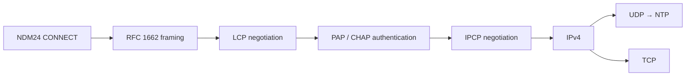

# PPP 実装方針

## 現在の範囲

最初のPPPマイルストーンは、NDM24から受け取る任意位置で分割されたbyte列を、FCS検証済みのPPPフレームへ復元する層です。`crates/ndm24-ppp` を仕様の参照実装とし、同じ状態遷移と試験ベクトルを65816へ移植しています。

現時点で実装済みなのはRFC 1662の非同期HDLC-like framingです。Rust参照実装に加えて、65816版の受信FCS検証、unescape、Flag境界、最大長判定、再同期、送信FCS付加、escape、NDM24のRX/TXリングへの上限付き接続を実装しています。LCP、認証、IPCP、IPv4、UDP、TCP、NTPはまだSFC上で動作しません。

PPP接続は次の順序で進みます。



LCPでlinkを確立し、必要なら認証を行い、その後IPCPでIPv4を有効にする順序は [RFC 1661](https://www.rfc-editor.org/rfc/rfc1661.html) と [RFC 1332](https://www.rfc-editor.org/rfc/rfc1332.html) に従います。

## 非同期フレーミング

初期実装はAddress/Control field compressionとProtocol field compressionを使わない標準形を扱います。

```text
Flag  Address  Control  Protocol  Information  FCS16  Flag
7E    FF       03       2 bytes   0..MRU       2 bytes 7E
```

- Flagは `$7E`。
- Control Escapeは `$7D`。escape後のbyteは `$20` とXORする。
- 送信側は最低でも `$7E` と `$7D` をescapeする。
- LCP交渉前のdefault ACCMは `$FFFFFFFF` とし、`$00`～`$1F` もescapeする。
- FCSはAddressからInformationまでを対象とする16bit FCSで、初期値は `$FFFF`。
- 送信時はFCSを反転し、下位byteから付加する。
- 受信時にFCSを含む列を計算した結果が `$F0B8` なら正常。
- FCS付加後にescapeし、受信側はunescapeとreceive ACCM除去をFCS検証前に行う。
- 連続Flagは空フレームとして無視する。
- 4byte未満、Flag直前がControl Escape、最大長超過はFCS errorとは別のinvalid/discardとして扱う。

これらは [RFC 1662](https://www.rfc-editor.org/rfc/rfc1662.html) section 3.1、4.1～4.3、Appendix C.2を基準とします。

空optionのLCP Configure-Requestを最初の固定試験ベクトルとします。

```text
unescaped, FCS included:
FF 03 C0 21 01 01 00 04 D1 B5

default ACCM, Flags included:
7E FF 7D 23 C0 21 7D 21 7D 21 7D 20 7D 24 D1 B5 7E
```

Rust参照実装は全入力分割位置、破損FCSからの再同期、Flag直前のescape、receive ACCMによる注入control文字の除去、最大長超過、default MRU 1500byteを試験します。送信側の `AsyncEncoder` は次のwire byteを `peek` し、NDM24 TX ringへ受理された後だけ `advance` します。拒否されたbyteは同じstageに残るため、escape prefixとescape後byteの間を含む任意位置から再開できます。

## 65816受信decoder

65816実装は次のファイルに分離しています。

- `src/ppp/constants.inc`: RFC 1662の定数、event、invalid理由
- `src/ppp/state.asm`: decoder状態とframe buffer
- `src/ppp/framing.asm`: byte単位の受信状態機械
- `src/ppp/receive.asm`: NDM24 RX ringの所有権と上限付きdrain
- `src/ppp/transmit.asm`: backpressure対応の送信encoderとTX ring充填
- `src/ppp/selfTest.asm`: 固定fixtureによる常設セルフテスト

`pppDecoderPush` はraw byteを1byteずつ受け取り、次のeventを返します。

| event | 意味 |
|---|---|
| `PPP_EVENT_NONE` | frameは未完成 |
| `PPP_EVENT_FRAME` | FCS検証済みframeが完成 |
| `PPP_EVENT_FCS_ERROR` | Flagまで受信したがFCS不一致 |
| `PPP_EVENT_INVALID` | 短すぎるframe、またはFlag直前のescape |
| `PPP_EVENT_OVERFLOW` | 1506byteを超え、次のFlagまで破棄 |

現在のreceive ACCMはLCP交渉前の `$FFFFFFFF` 固定です。LCPでACCMを交渉する段階で可変化します。

セルフテストはモデムや電話回線を必要とせず、FXPAK PROで起動したsmoke ROMに対して実行できます。

```powershell
cargo run -p ndm24-tools -- mailbox ppp-self-test
```

正常frameとProtocol `$C021` の復元、破損FCS、Flag直前のescape、receive ACCMによるXON除去をSFC上で検査します。失敗時のmailbox resultは、`src/ppp/selfTest.asm` 内の失敗step番号です。

## NDM24 RX ringとの接続

PPP受信は通常無効です。これにより、既存の `binary_receive` を使ったraw転送試験がCONNECTED状態でも従来どおりRX ringを所有できます。PPP受信を試すときだけ明示的に所有権を切り替えます。

```powershell
cargo run -p ndm24-tools -- mailbox ppp-receive-start
cargo run -p ndm24-tools -- mailbox ppp-receive-stop
```

有効化後、`pppReceivePoll` はNDM24がCONNECTEDの間だけ、1回につき最大32byteをRX ringからdecoderへ渡します。FCS検証済みframeが完成すると `pppFrameReady` を立て、そのframeを上位層が `pppReleaseFrame` で解放するまで追加のRX byteを消費しません。これにより、完成frameを次の入力で上書きしません。

常設カウンタとしてraw受信byte、正常frame、FCS error、invalid、overflow、32byte drain budget到達回数をWRAMに保持します。これらは後述のversioned PPP診断blockからQUsb2Snes経由で確認できます。

## NDM24 TX ringとの接続

上位層はAddress、Control、Protocol、Informationを `pppTransmitBuffer` へ構築し、FCSとFlagを含まない長さを `pppTransmitBegin` へ渡します。encoderは次のstageを保持します。

```text
opening Flag → frame → FCS low → FCS high → closing Flag
```

`pppTransmitPoll` はCONNECTED中に1回最大32wire byteをNDM24 TX ringへ追加します。TX ringが満杯なら現在byteをadvanceせずに戻るため、escape prefixをqueueした直後を含む任意位置から再開できます。完成frame全体をescape済みの別bufferへ複製しません。

送信bufferは1504byteで、非圧縮Address、Control、Protocolとdefault MRU 1500byteを保持します。受信1506byte bufferとともにWRAM `$7E2000` 以降の `PPP_BSS` へ配置し、NDM24の低レベル転送がbank `$80` mirrorで参照する先頭8KiBから分離しています。

送信wire byte、完成frame、TX ring backpressure、carrier喪失によるabortを常設カウンタへ残します。送信途中でCONNECTED以外へ遷移したframeは破棄し、次の接続へ持ち越しません。

## SFC のメモリと接続境界

default MRUは1500byteです。非圧縮時にFlag間で必要な最大unescaped長は次の1506byteです。

```text
Address 1 + Control 1 + Protocol 2 + Information 1500 + FCS 2
```

受信側はNDM24の255byte RX ringを一度に保持領域として使わず、byte単位でPPP decoderへdrainします。完成前のフレームだけを専用WRAM bufferへ保持し、Flag到着時にFCSを判定します。これにより、回線上の1フレームがRX ring容量を超えても処理できます。

送信側はescape後の全frameを別bufferへ複製しません。unescaped frameとFCSを順に読み、escape状態を保持しながらNDM24 TX ringの空きに応じて再開できるstate machineです。最悪時にescapeで約2倍になるframeをWRAMへ二重保持しません。

## 常設PPP診断

`pppDiagnosticState` はmagic `PPP1`、ABI version 1、96byteの公開診断blockです。レイアウトの正本は `spec/ndm24.toml` で、AssemblyとRustのoffset定数および[生成済みABI表](generated/diagnostic-abi.md)を同時に生成します。

PC側では次のコマンドでJSON Linesとして読み取れます。

```powershell
cargo run -p ndm24-tools -- ppp-monitor --once
cargo run -p ndm24-tools -- ppp-monitor
```

診断blockはsequence lock方式です。SFCは公開状態を変更する前後に32bitの `snapshot_sequence` を更新し、PC側は偶数の同じsequenceで2回読めたblockだけを採用します。入れ子更新も深さを管理するため、常設セルフテストの途中状態を安定したsnapshotとして誤認しません。

公開する内容は次の通りです。

- 正常受信frame数
- FCS error数
- invalid frame数
- frame buffer overflow数
- 最後に受信したPPP protocol
- decoderのflags、長さ、FCS
- encoderのstage、長さ、位置、FCS
- 送受信byte数、TX ring backpressure数、carrier喪失によるabort数

認証frameには利用者IDやpasswordが含まれ得るため、常設traceへpayload全体は保存しません。protocol、code、identifier、length、エラー理由までを診断対象とし、credential byte列は記録対象外とします。

## Rust LCP packet codec

`crates/ndm24-ppp/src/lcp.rs` は [RFC 1661 section 5および6](https://www.rfc-editor.org/rfc/rfc1661.html) と、非同期回線用ACCMを追加する [RFC 1662 section 7](https://www.rfc-editor.org/rfc/rfc1662.html) に対応する、allocation-freeのLCP packet参照codecです。現時点では状態遷移やtimerを持たず、次の構文処理だけを担当します。

- `Code`、`Identifier`、network byte orderの16bit `Length`、`Data` の解析
- `Length` より後ろにあるpaddingの除外
- 未知のCodeをCode-Reject用にraw値のまま保持
- Configuration Optionの `Type`、`Length`、`Data` をcopyせず順次走査
- 未知のOption TypeをConfigure-Reject用にencoded byte列のまま保持
- Configure-AckのIdentifierとOptionsが送信済みConfigure-Requestに完全一致するかの検査
- 呼び出し側bufferへLCP packetを直接構築するencoder

短いheader、4未満または入力末尾を越えるpacket Length、2未満または残り領域を越えるoption Lengthは、状態機械が黙って破棄する判断を行えるよう個別のerrorとして返します。

## Rust LCP Configure状態機械

`crates/ndm24-ppp/src/lcp/negotiation.rs` は [RFC 1661 section 4](https://www.rfc-editor.org/rfc/rfc1661.html) のestablishment部分を参照実装します。今回の対象は `Request-Sent`、`Ack-Received`、`Ack-Sent`、`Opened` と、Configure用restart timerです。Link termination、Echo、PAP packet、IPCPはまだ含みません。

状態機械への入力と出力は分離しています。

- 入力: lower layerのopen/down、現在時刻、受信LCP packet
- 出力: 送信LCP packet、`ThisLayerUp`、`ThisLayerDown`、`ThisLayerFinished`
- Configure-RequestのIdentifierは内容変更または有効な応答後に更新
- timeout再送は同じIdentifierとoption列を使用
- restart intervalの既定値は3秒、Max-Configureは10回
- Configure-AckはIdentifierと送信済みoption列が完全一致した場合だけ受理
- 不正Length、不正option、out-of-sequence応答は状態を変えずに破棄

最初のSFC実装ではlocal Configure-Requestを空optionにできます。これは既定MRU 1500と既定ACCM `$FFFFFFFF` を維持し、未実装の圧縮を要求しない構成です。peer側Configure-Requestには次の保守的方針で応答します。

| peer option | 現在の応答 |
|---|---|
| MRU | 正しいLengthかつ0以外ならAck |
| ACCM | 32bit値ならAckし、送信ACCMとして保存 |
| Authentication-Protocol | PAPならAck、CHAP等にはPAPをNak |
| Magic-Number | 正しいLengthかつ0以外ならAck |
| PFC / ACFC | 65816 framingが未対応のためReject |
| Quality-Protocol / unknown / duplicate | Reject |

Configure-Rejectが必要なoptionとConfigure-Nak候補が同じRequestに含まれる場合は、RFCの優先関係に従ってReject対象だけを順序・内容を変えず返します。受理したMRU、ACCM、PAP要求、peer Magic-Numberは双方のConfigure-Ackが成立した `ThisLayerUp` と同時に上位層へ渡します。

固定transcript試験では、Ackの到着順が前後する2経路、Opened到達、timeout再送と回数超過、Nakによるlocal option置換、Rejectによる除去、Opened中の再交渉を検査します。状態機械が返すpacketはLCPの `Code` から始まるInformation部分であり、Address `$FF`、Control `$03`、Protocol `$C021` とRFC 1662 framingの付加は下位層の責務です。

## 次の実装

次はLCP packet parserとestablishment状態を65816へ移植し、既存の受信frame所有権・送信encoder・PPP診断blockへ接続します。その常設セルフテストまでは対向PPPサーバーを必要としません。実際のpeerとのLCP交渉を始める段階で対向PPPサーバーを用意します。
