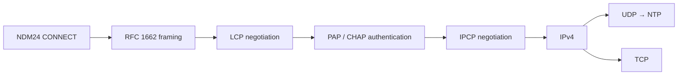

# PPP 実装方針

## 現在の範囲

最初のPPPマイルストーンは、NDM24から受け取る任意位置で分割されたbyte列を、FCS検証済みのPPPフレームへ復元する層です。`crates/ndm24-ppp` を仕様の参照実装とし、同じ状態遷移と試験ベクトルを65816へ移植します。

現時点で実装済みなのはRFC 1662の非同期HDLC-like framingだけです。LCP、認証、IPCP、IPv4、UDP、TCP、NTPはまだSFC上で動作しません。

PPP接続は次の順序で進みます。



LCPでlinkを確立し、必要なら認証を行い、その後IPCPでIPv4を有効にする順序は [RFC 1661](https://www.rfc-editor.org/rfc/rfc1661.html) と [RFC 1332](https://www.rfc-editor.org/rfc/rfc1332.html) に従います。

## 非同期フレーミング

初期実装はAddress/Control field compressionとProtocol field compressionを使わない標準形を扱います。

```text
Flag  Address  Control  Protocol  Information  FCS16  Flag
7E    FF       03       2 bytes   0..MRU       2 bytes 7E
```

- Flagは `$7E`。
- Control Escapeは `$7D`。escape後のbyteは `$20` とXORする。
- 送信側は最低でも `$7E` と `$7D` をescapeする。
- LCP交渉前のdefault ACCMは `$FFFFFFFF` とし、`$00`～`$1F` もescapeする。
- FCSはAddressからInformationまでを対象とする16bit FCSで、初期値は `$FFFF`。
- 送信時はFCSを反転し、下位byteから付加する。
- 受信時にFCSを含む列を計算した結果が `$F0B8` なら正常。
- FCS付加後にescapeし、受信側はunescapeとreceive ACCM除去をFCS検証前に行う。
- 連続Flagは空フレームとして無視する。
- 4byte未満、Flag直前がControl Escape、最大長超過はFCS errorとは別のinvalid/discardとして扱う。

これらは [RFC 1662](https://www.rfc-editor.org/rfc/rfc1662.html) section 3.1、4.1～4.3、Appendix C.2を基準とします。

空optionのLCP Configure-Requestを最初の固定試験ベクトルとします。

```text
unescaped, FCS included:
FF 03 C0 21 01 01 00 04 D1 B5

default ACCM, Flags included:
7E FF 7D 23 C0 21 7D 21 7D 21 7D 20 7D 24 D1 B5 7E
```

Rust参照実装は全入力分割位置、破損FCSからの再同期、Flag直前のescape、receive ACCMによる注入control文字の除去、最大長超過、default MRU 1500byteを試験します。

## SFC への移植境界

default MRUは1500byteです。非圧縮時にFlag間で必要な最大unescaped長は次の1506byteです。

```text
Address 1 + Control 1 + Protocol 2 + Information 1500 + FCS 2
```

受信側はNDM24の255byte RX ringを一度に保持領域として使わず、byte単位でPPP decoderへdrainします。完成前のフレームだけを専用WRAM bufferへ保持し、Flag到着時にFCSを判定します。これにより、回線上の1フレームがRX ring容量を超えても処理できます。

送信側はescape後の全frameを別bufferへ複製しません。unescaped frameとFCSを順に読み、escape状態を保持しながらNDM24 TX ringの空きに応じて再開できるstate machineとします。最悪時にescapeで約2倍になるframeをWRAMへ二重保持しないためです。

常設診断には少なくとも次を追加する予定です。

- 正常受信frame数
- FCS error数
- invalid frame数
- frame buffer overflow数
- 最後に受信したPPP protocol
- decoderとencoderの内部stage

認証frameには利用者IDやpasswordが含まれ得るため、常設traceへpayload全体は保存しません。protocol、code、identifier、length、エラー理由までを診断対象とし、credential byte列は記録対象外とします。

## 次の実装

次はRust参照実装と同じbitwise FCS更新、unescape、Flag境界、最大長判定を65816へ移植します。実回線へ発信する前に、固定fixtureをSFC上で投入し、Rustと同じframeまたは同じdiscard理由になることをQUsb2Snesから検証します。
