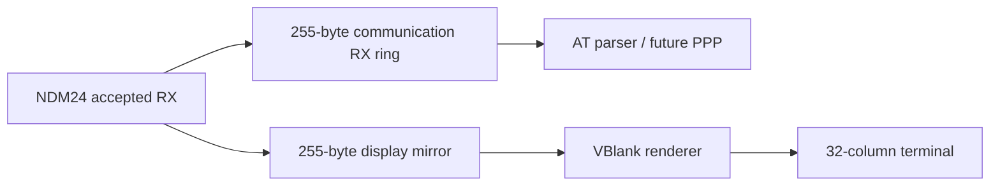

# 32文字幅ターミナルと画面切替

## 目的

添付の実機記録で使用していた低解像度ターミナルを、生ログ確認用のデバッグ画面として常設します。80×24高解像度POCとそのHDMA、window、生成素材は削除済みです。

通常ROMは人間向けステータス画面で起動します。`R`ボタンで生ログ画面、`L`ボタンでステータス画面へ切り替えます。非表示中も生ログの表示ミラーとtilemapは更新を続けるため、ステータス画面から戻っても直近の通信内容を確認できます。

次のヘッダーはステータス画面だけに表示します。

```text
modem-control-test
--------------------------------
```

スモークテストROMはraw `R`による初期化後に `ATM0 CR LF` を送り、NDM24から返ったechoと結果コードを生ログ画面へ出力します。`M0` は電源再投入後にもスピーカーを無効化する標準設定です。送信内容をローカルechoしないため、NDM24のechoと二重表示になりません。

## 表示構成

- SNES BG mode 0
- 8×8 pixel font
- ステータス: 32列×32行、BG1 tilemap base VRAM `$4000`
- 生ログ: 32列×64行の循環tilemap、BG1 tilemap base VRAM `$4800`
- 生ログは受信に追従して自動vertical scroll
- VBlankごとに生ログを最大32バイト、ステータスを1行描画
- VBlank内部ではX/Yを16ビット幅へ正規化してから描画処理を呼び、割り込み時のCPU幅にかかわらず保存・復元するスタック量を一致させる

印字可能ASCIIにはPublic Domain表記のあるfont8x8を使用します。背景は完全な黒、文字はSFC BGR555の`$6F7B`（`RGB(222,222,222)`相当）です。`assets/font.bin`、`assets/palette.bin`は直接編集せず、`cargo xtask generate`で生成します。

列数、行数、tilemap、表示キュー、描画上限、配色の正本は`spec/ndm24.toml`の`[terminal]`です。フォントの出所と確認方法は [font8x8の出所・生成・確認手順](font.md)にあります。

ステータス画面の行構成、ソフトウェア時計、アプリケーション差し替え境界は [ステータス画面とアプリケーション・アダプター](status-screen.md) に記録します。

## 表示ミラー

通信RXと表示RXは所有権を分離しています。



表示ミラーは256バイトを確保し、read indexとwrite indexの一致を空状態に使うため実容量は255バイトです。満杯の場合は最古の表示待ちバイトを捨て、最新の出力を保存します。破棄数は診断ABIの32ビット `terminal_dropped` で確認できます。

この破棄は表示だけに作用します。通信RXリング、AT解析、将来のPPP入力は変更しません。

## 文字処理

| byte | 動作 |
|---:|---|
| `$0D` | 現在行の先頭へ移動 |
| `$0A` | 次の行の先頭へ移動 |
| `$08` | カーソルを1文字戻す |
| `$20`–`$7E` | ASCII tileを描画 |
| その他 | 描画せず無視 |

ANSI escape sequence、色、任意cursor positioningは未対応です。未対応文字を描画しない場合も、元の通信RXデータは変更しません。
