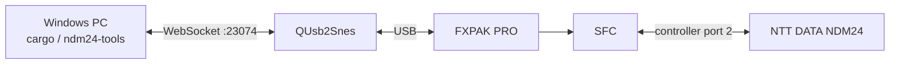

# Windows 開発環境

## 構成

開発用 PC 上で Rust、cc65、QUsb2Snes を動かし、USB 接続した FXPAK PRO へ ROM を転送します。SFC 上のスモークテスト ROM は、NDM24 の状態を versioned WRAM block、循環トレース、制御メールボックスへ公開します。



## 初回セットアップ

1. 64 ビット版 Windows に Rust stable を導入します。
2. QUsb2Snes を起動し、FXPAK PRO を認識させます。
3. リポジトリの PowerShell で次を実行します。

```powershell
cargo xtask bootstrap
cargo xtask check
```

`bootstrap` は `spec/toolchain.toml` に URL と SHA-256 を固定した cc65 Windows snapshot を取得し、`.tools/cc65` に展開します。システム全体の PATH は変更しません。

## 日常のコマンド

```powershell
# 通常 ROM
cargo xtask rom

# 起動直後から NDM24 初期化を始める ROM
cargo xtask rom --smoke

# ビルド、FXPAK PRO への転送、起動
cargo xtask deploy --smoke

# 一度だけ診断スナップショット
cargo run -p ndm24-tools -- monitor --once

# 継続監視（1 行 1 JSON）
cargo run -p ndm24-tools -- monitor

# メールボックス経由の AT クイックテスト
cargo run -p ndm24-tools -- test

# 有効な循環トレースを時系列 JSON で出力
cargo run -p ndm24-tools -- trace-live

# トレースの凍結、消去、再開
cargo run -p ndm24-tools -- mailbox freeze-trace
cargo run -p ndm24-tools -- mailbox clear-trace
cargo run -p ndm24-tools -- mailbox resume-trace
```

既定の WebSocket endpoint は QUsb2Snes の `ws://localhost:23074` です。別の endpoint、ROM の SD カード上の配置先、label file は各コマンドの option で変更できます。

`deploy` は QUsb2Snes の `PutFile` で ROM を 1024 バイト以下の chunk に分けて送り、`Boot` を要求します。WRAM の監視とメールボックス操作には `GetAddress` と `PutAddress` を使います。

## PC 側疑似回線 peer

USB serial 接続した相手側モデムを auto-answer にして、接続後のバイトを echo する補助コマンドがあります。

```powershell
cargo run -p ndm24-tools -- peer --port COM5 --baud 115200
```

これは PC と相手モデム間の DTE baud です。回線上の通信速度とは別なので、使用するモデムの設定に合わせます。疑似電話交換機を含む配線と試験条件は [hardware-test.md](hardware-test.md)を参照してください。

## 仕様変更

1. `spec/ndm24.toml` を変更します。
2. `cargo xtask generate` を実行します。
3. 生成された Assembly、Rust、Markdown の差分を確認します。
4. `cargo xtask check` を通します。

CI でも `cargo xtask check` を実行するため、生成物だけ、または正本だけを変更した状態は通りません。
