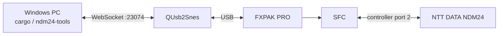

# Windows 開発環境

## 構成

開発用 PC 上で Rust、cc65、QUsb2Snes を動かし、USB 接続した FXPAK PRO へ ROM を転送します。SFC 上のスモークテスト ROM は、NDM24 の状態を versioned WRAM block、循環トレース、制御メールボックスへ公開します。

通常ROMとスモークテストROMはどちらも32文字幅ターミナルを表示します。通常ROMはNDM24を自動初期化せず、スモークテストROMはraw `R`、`AT`、受信echo、結果コードを起動後に表示します。

ROM bank 0はSNES header・vector直前までPPPとドライバの実行コードに使い、
人間向けステータス画面のコードは`BANK1_CODE`としてbank 1へ配置します。
bankを跨ぐ4つの公開入口は`JSL`/`RTL`で呼び、画面モジュール内部のhelperは
同じbank内の`JSR`/`RTS`を維持します。今後のプロトコル追加でbank 0のheader
領域へコードが衝突しないための固定配置です。

フォント確認ROMはNDM24を初期化せず、印字可能ASCIIと判別用文字列を表示します。font8x8の出所、変換、配色は [font.md](font.md)を参照してください。



## 初回セットアップ

1. 64 ビット版 Windows に Rust stable を導入します。
2. QUsb2Snes を起動し、FXPAK PRO を認識させます。
3. リポジトリの PowerShell で次を実行します。

```powershell
cargo xtask bootstrap
cargo xtask check
```

`bootstrap` は `spec/toolchain.toml` に URL と SHA-256 を固定した cc65 Windows snapshot を取得し、`.tools/cc65` に展開します。システム全体の PATH は変更しません。

## 日常のコマンド

```powershell
# 通常 ROM
cargo xtask rom

# 起動直後から NDM24 初期化を始める ROM
cargo xtask rom --smoke

# font8x8 の全印字可能 ASCII を確認する ROM
cargo xtask rom --font-test

# ビルド、FXPAK PRO への転送、起動
cargo xtask deploy --smoke

# フォント確認 ROM を転送して起動
cargo xtask deploy --font-test

# MesenCE上でNDM24を使わずPPP常設セルフテスト
cargo xtask mesen-test

# 一度だけ診断スナップショット
cargo run -p ndm24-tools -- monitor --once

# 継続監視（1 行 1 JSON）
cargo run -p ndm24-tools -- monitor

# PPP framing の状態を一度だけ表示
cargo run -p ndm24-tools -- ppp-monitor --once

# PPP framing の状態を継続監視（1 行 1 JSON）
cargo run -p ndm24-tools -- ppp-monitor

# frameCounterと同期後の内部時計を実時間と比較
cargo run -p ndm24-tools -- frame-rate --seconds 15

# 実機コントローラー入力、立ち上がりpulse、画面mode/pageを一定時間監視
cargo run -p ndm24-tools -- input-monitor --seconds 15

# IPCP Opened後、peerのUDP 123へNTP要求を送り、応答または失敗まで待つ
cargo run -p ndm24-tools -- ntp-request

# IPCP Opened後、任意のIPv4 addressへICMP Echoを送り、相関済み応答まで待つ
cargo run -p ndm24-tools -- icmp-echo 1.1.1.1

# IPCP Opened後、任意のresolverへDNS A問い合わせを送り、最初のIPv4回答を表示
cargo run -p ndm24-tools -- dns-query example.com --resolver 1.1.1.1

# メールボックス経由の AT クイックテスト
cargo run -p ndm24-tools -- test

# 任意の AT コマンドを1回送り、OKまで確認（ATM0は通常の初期化で自動送信）
cargo run -p ndm24-tools -- at ATM0

# PPP接続では発信前に受信を有効化し、CONNECTを正規parserで待つ
cargo run -p ndm24-tools -- mailbox ppp-receive-start
cargo run -p ndm24-tools -- ppp-dial

# 次のtransactionへ持ち越される未処理RX byteをJSON配列で確認
cargo run -p ndm24-tools -- pending-rx

# 有効な循環トレースを時系列 JSON で出力
cargo run -p ndm24-tools -- trace-live

# トレースの凍結、消去、再開
cargo run -p ndm24-tools -- mailbox freeze-trace
cargo run -p ndm24-tools -- mailbox clear-trace
cargo run -p ndm24-tools -- mailbox resume-trace
```

`frame-rate`はQUsb2Snesから`frameCounter`、UTC Unix秒、32-bit小数部を安定
読取し、指定時間後との差をJSONで返します。`frames_per_second`はNTSC実機で
約60.1、NTP同期後の`clock_elapsed_seconds`は`elapsed_seconds`とほぼ一致する
ことが合格条件です。画面の行更新や映像キャプチャの遅延を介さず、時計の基準と
内部進行を分離して診断できます。

## MesenCE 自動セルフテスト

[MesenCE](https://github.com/nesdev-org/MesenCE)のheadless test runnerを使い、
通常ROMのWRAMメールボックスへ
`ppp-self-test`を投入して終了コードで合否を返します。通常ROMは起動時にNDM24を
初期化しないため、この試験ではNDM24、FXPAK PRO、QUsb2Snes、疑似PSTNを
使用しません。ROMと`.dbg`、`.lbl`は毎回同じビルドから生成し、メールボックス
アドレスは`.lbl`から解決します。Lua側でもmailbox magic、ABI version、block
sizeを照合してから命令を書き込みます。

2026-07-30時点の確認環境はMesenCE 2.2.1
（commit `20ba206cef5ba207c21203176d02cb9f43dda9fb`、Windows x64、
`Mesen.exe` SHA-256
`8EF403D6B9AF32075416193914D7993CE8480B347FE1F20A0CFD9815374933E7`）です。
実行ファイルは次の優先順位で見つけます。

1. `--mesen <path>`
2. 環境変数`MESEN_EXE`
3. `PATH`上の`Mesen.exe`
4. `%USERPROFILE%\PortableApps\Mesen\Mesen.exe`

現在のPortableApps配置では、引数なしで実行できます。

```powershell
cargo xtask mesen-test
```

別の配置を明示する場合:

```powershell
cargo xtask mesen-test --mesen C:\path\to\Mesen.exe
```

`build/mesen/ppp-self-test.lua`は、テンプレート、現行mailbox ABI、リンク後の
labelから生成されます。成功時は終了コード0です。PPP fixtureが失敗した場合は
失敗step番号を1～249の終了コードとして返し、`xtask`が16進のstep番号を表示します。
ABI version不一致は250、block size不一致は251、600 emulated frames以内に
初期化または完了しない場合は252です。timeout時のMesenCEメッセージにはmailboxの
status、result、processed sequenceも表示します。MesenCE自身のwall-clock timeoutは既定
30秒で、必要なら`--timeout-seconds`で変更できます。
このコマンドは実機試験を置き換えず、65816のPPP/IPv4ロジックを高速に回帰確認する
第一段階として使います。

NDM24自身の識別情報を読み取り専用ATコマンドで収集する場合は、hardware revisionを指定します。

```powershell
cargo run -p ndm24-tools -- identify --revision B
```

`ATI`、`ATI0`～`ATI9`、`AT+GMI`、`AT+GMM`、`AT+GMR`、`AT+GSN`、`AT+GCAP` を順に実行します。未対応コマンドの `ERROR` も機器特性として記録し、発信や設定変更は行いません。raw response、行単位の応答、trace、snapshotは `build/hardware-tests/<test-id>/at-identification.json` に保存します。

既定の WebSocket endpoint は QUsb2Snes の `ws://localhost:23074` です。別の endpoint、ROM の SD カード上の配置先、label file は各コマンドの option で変更できます。

`deploy` は QUsb2Snes の `PutFile` で ROM を 1024 バイト以下の chunk に分けて送り、同じ WebSocket 接続上で `Boot` と `Info` を続けて要求します。`Info` が転送先 ROM を実行中と返すまで接続を維持し、実際の起動を確認してから成功とします。

FXPAK PRO の `SNES` 空間にある `$F50000` 以降は、実WRAMではなくカートリッジ側の観測用コピーです。診断読み取りには `GetAddress` を使えますが、同じ場所への通常の `PutAddress` はSFC CPUから見えません。メールボックス命令は、レジスタを保存してWRAMの入力arguments、command、host sequenceを書き換える短い65816コードを `$3F0000` のscratchへ置き、`PutAddress` の `SETX` flagで次のNMIに実行します。processed sequence、status/result、SFC専用outputは観測用コピーから読み戻します。mailbox ABI version 4ではホスト入力とSFC出力を別の32byte領域に分離し、TX最大burst用のデバッグ命令を追加しています。

## PC 側疑似回線 peer

USB serial 接続した相手側モデムを auto-answer にして、接続後のバイトを echo する補助コマンドがあります。

```powershell
cargo run -p ndm24-tools -- peer --port COM5 --baud 115200
```

これは PC と相手モデム間の DTE baud です。回線上の通信速度とは別なので、使用するモデムの設定に合わせます。疑似電話交換機を含む配線と試験条件は [hardware-test.md](hardware-test.md)を参照してください。

接続・切断までの自動実機試験では、後期NDM24を接続したsmoke ROMを起動してから次を実行します。

```powershell
cargo run -p ndm24-tools -- connect-test --revision B --port COM5
```

このコマンドはDFM-56UをV.22bis 2400bpsの自動応答に設定し、SFCへ `AT&F`、`ATM0`、`AT%B2400`、`ATS7=60`、`ATX3`、`ATDT0` を順次要求します。`AT&F` で既定値へ戻ったスピーカー設定を直後の `ATM0` で再適用します。両側の `CONNECT` 後に10秒保持し、DFM-56UのDTRを落としてNDM24側の `NO CARRIER` まで確認します。結果は `build/hardware-tests/<test-id>/connect-test.json` に保存し、終了時にDFM-56Uへ `ATZ` を送ります。

接続後の8bit透過性を確認するには、同じ配線で次を実行します。

```powershell
cargo run -p ndm24-tools -- binary-test --revision B --port COM5
```

このコマンドは双方のflow controlを使わずV.22bis 2400bpsで接続し、`0x00` から `0xFF` までをNDM24→DFM-56U、DFM-56U→NDM24の順に転送します。さらに、SFCのTX ring全容量へ `0x00`～`0xFE` の255byteを一度にqueueする最大burst試験も行います。SFC側とはQUsb2Snes mailboxを介して値、順序、欠落、重複、ring overflow、Data2 traceを照合します。受信方向は各chunkの回線到着を待ち、mailboxで取り出す直前のRX ringも記録します。結果は `build/hardware-tests/<test-id>/binary-pattern-test.json` に保存します。

## WSL2 PPPサーバー

LCP以降の試験では、DFM-56UをUSBIPでUbuntu 22.04へattachし、WSL2上の
`pppd`を対向serverとして使います。導入、回線を使わないAT probe、待受開始、
状態確認、ログ取得、停止はPowerShellから統合して操作できます。

`Start`はSFCの`10.24.0.2`だけを対象とするIPv4 forwardingとNATも適用し、
`Stop`で規則と一時状態を撤去します。`Status`の`sharing=active`で適用状態を
確認できます。外部からSFCへの新規接続を許可するport forwardingは行いません。

```powershell
.\tools\ppp-server\ndm24-ppp-server.ps1 Install
.\tools\ppp-server\ndm24-ppp-server.ps1 Probe
.\tools\ppp-server\ndm24-ppp-server.ps1 Stop
```

疑似PSTNへ接続する前提、DFM-56Uの固定条件、LCP試験の合格条件は
[WSL2 PPPサーバー](ppp-server.md)を参照してください。

## 仕様変更

1. `spec/ndm24.toml` を変更します。
2. `cargo xtask generate` を実行します。
3. 生成された Assembly、Rust、Markdown、font、palette、PNG の差分を確認します。
4. `cargo xtask check` を通します。

CI でも `cargo xtask check` を実行するため、生成物だけ、または正本だけを変更した状態は通りません。
